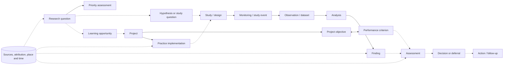
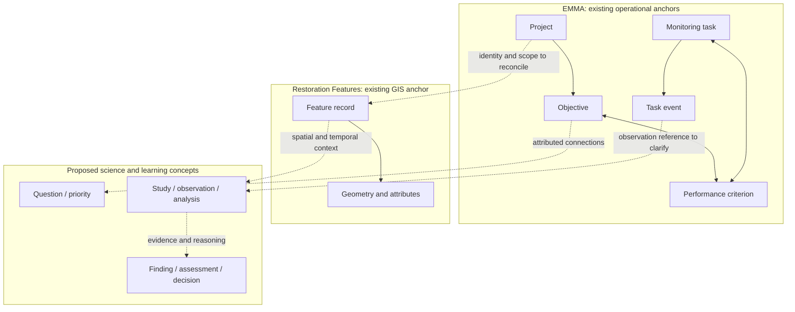

# Data model design report

## Purpose and review status

This report presents the **current conceptual design** for the science and restoration integration component of EMMA. It is intended to help practitioners, data stewards and developers discuss what information the model must distinguish, how evidence can be connected, and what remains to be decided before implementation.

The intended result is a family of reports that can start with a research question, study, project or another selected item, then follow relevant relationships toward both conceptual context and observations, findings and decisions. A reader should be able to inspect why an item was included and drill down to the evidence. This is a design objective, not a claim that the current prototype searches all program information.

**Status:** the attributed linkage pattern has been accepted by the user for further validation. The objects and relationships in this report are working proposals, except where specifically identified as existing system structure or user direction. They are not an approved database schema, ontology, mandated workflow, complete inventory, or an assertion that production records already exist. EMMA is the user-identified **likely system of record for practitioner-authored findings, assessments and decisions for design purposes**; detailed ownership, schema and implementation are unresolved.

The [science and adaptive-management tooling watch](../goals/science-am-tooling-watch.md) identifies concrete software and models for targeted reuse. The bounded review did not find a verified open, end-to-end replacement; continue conceptual and reporting work while testing relevant components. This report remains a conceptual description, not a committed implementation.

The [bounded Bertom mapping](bertom-tool-model-mapping.md) compares monitoring, intended results, evidence and analysis concepts with AMMonitor, Miradi, SEPIO and AMModels. It records proposed analogies and limits, not validated imports or approved schema changes.

## The model at a glance

The model brings together a learning agenda, restoration activities, scientific evidence and adaptive-management judgments. The diagram is a **map of possible connections**, not a mandatory sequence. A study may address a question without a formal hypothesis; historical evidence may be useful without a recorded EMMA monitoring task; and a finding need not lead to a documented decision.

Arrows show conceptual direction, not physical foreign keys, required stages, verified coverage or causal proof. The objective–criterion relationship is many-to-many in the supplied EMMA export; the diagram's double arrow represents this association, not a reverse causal claim. EMMA also documents a many-to-many task–criterion relationship, shown separately below. Other multiplicities remain open. Each material connection needs its own meaning, attribution and context; a general line between two boxes is not sufficient evidence.

## What the model needs to distinguish

| Concept | Working meaning | Why the distinction matters | Current design basis |
| --- | --- | --- | --- |
| **Research question** | A question about an ecological or management uncertainty | A question is not a hypothesis or a finding. Preserve original wording and source. | Workshop questions supply concrete examples; WQ IDs are local review references. |
| **Priority assessment** | A particular ranking or prioritization of a question, in a stated reach and assessment edition | Priority can differ by reach and over time; it is not evidence strength or scientific confidence. | Supplied workshop workbook and [priority review](../goals/workshop-research-priorities.md). |
| **Hypothesis or proposition** | A testable statement about an expected relationship under stated conditions | Keep source-stated hypotheses separate from analyst formulations, management objectives and actual results. | Candidate scientific concept; naming and ontology alignment remain under review. |
| **Learning opportunity** | A reviewable rationale for why a project, study or action may help address a question | A workbook association is not a selected opportunity or proof that a question was tested. | Proposed concept informed by the developing FWWG framework; not a confirmed FWWG workflow. |
| **Project and objective** | A restoration project and the conditions or outcomes it intends to achieve | A project can have several objectives; objectives are distinct from features and observed outcomes. | Existing EMMA project/objective structures; historical documents and UMRRDB provide additional references. |
| **Performance criterion** | A specified measure or condition used to evaluate progress toward one or more objectives | Preserve its version, target, method and applicable time when known. A historical target is not automatically an evaluated EMMA criterion. | Existing EMMA criterion and objective cross-reference structures. |
| **Practice, implementation and geometry** | A restoration action, its particular planned or built occurrence, and its spatial representation | A practice type, an installed feature, a geometry and condition at a given time are related but different. | Restoration Features provides the production GIS anchor; exact cross-system identity rules remain unresolved. |
| **Study, design and event** | An investigation and its methods/comparisons; a particular collection or execution occurrence | A planned study, a performed survey and an EMMA operational task are not interchangeable. | Source reports and EMMA task/event structures; the detailed integration is open. |
| **Observation, dataset and analysis** | A measurement or result; an organized collection of data; the activity or method that derives results | A report summary is not raw observations; a dataset is not an analysis, and an event is not a biological measurement. | Existing conceptual observation direction; production storage and data references are unverified. |
| **Finding** | An attributed, scoped statement about what evidence indicates, including an inconclusive result | A measured result, author interpretation and later applicability judgment must remain distinguishable. | Source-backed findings exist; direct practitioner-created findings are a proposed capability. |
| **Assessment** | An attributed judgment about evidence relative to a question, criterion or other stated frame | Scientific assessment, criterion evaluation and objective/project assessment may use related evidence but answer different questions. “Insufficient evidence” can itself be a useful bounded judgment. | Proposed durable judgment; EMMA is the likely future record system for design purposes. |
| **Decision, action and follow-up** | A choice or deferral; what was intended or performed; and what should be revisited | A recommendation is not an adopted decision, and a decision is not proof an action occurred. | Proposed durable concepts; a formal assessment report may become a future artifact, but is not an existing requirement. |
| **Source, attribution and review** | The artifact or contributor, precise locator, author, applicable scope, review state and history behind a statement or link | Allows a future user to verify evidence, distinguish interpretation from source text, and retain revisions or disagreement. | Accepted attributed-linkage pattern; exact representation, ownership and workflow are open. |

These are **conceptual distinctions**, not instructions to create one table or class for every row. A source may use different terms. A single artifact can describe several concepts, and one concept may be supported by multiple artifacts or contributors.

## Existing systems and proposed extensions

The solid EMMA relationships reflect the supplied structural export, including many-to-many objective–criterion and monitoring-task–criterion associations. The export documents reference columns and comments; it does not establish that every intended relationship is enforced by a deployed foreign key. It also does not settle where ecological observations are stored. See the [production schema review](production-schema-review.md).

Restoration Features records physical practices and their geometry, classifications and status. A feature's project number or name may support a **candidate** association with another system, but the authoritative project crosswalk, feature identity across classes and historical condition still need confirmation. Source publications, datasets and partner holdings remain important evidence anchors. For new practitioner-authored judgments, EMMA is the likely home for design purposes; this is not a deployed schema or a decision to duplicate all external evidence there.

## Relationships carry meaning and evidence

The accepted working pattern is an **attributed linkage**: a precise statement connecting two identifiable things, supported by source or contributor, scope, lifecycle/review state and responsible role or system when known. The pattern is accepted for validation; its exact fields, storage and workflow are not approved. See the [minimum linkage pattern](prospective-study-linkage-minimum-record.md).

For example, these statements have different meanings and must not collapse into one generic “related to” link:

| Connection | Meaning that a report should be able to explain | Evidence or qualification to retain |
| --- | --- | --- |
| Question → project | A project is a candidate learning opportunity for a question. | Who or what supplied the connection, why it is relevant, reach and time, and whether it was selected or remains proposed. |
| Objective → criterion | A criterion contributes to evaluating an objective. | The existing EMMA cross-reference; multiple objectives and criteria may share links. |
| Criterion ↔ monitoring task | A task supports a criterion. | Existing EMMA many-to-many association; task completion does not itself establish a measured ecological result. |
| Implementation → study | A particular feature or action has a stated role in a study. | Whether it is a treatment, comparison, exposure, context or candidate; source and location/time evidence. |
| Observation / dataset → finding | An analysis and interpretation use specified evidence to reach a finding. | Method, data version, author, limits and any contradictory or inconclusive result. |
| Finding → assessment → decision | Evidence informs a judgment, which may inform a choice or deferral. | Evidence considered, reasoning, responsible contributor, uncertainty, review/adoption state and later revisions. |

The same connection may be traversed in either direction for discovery, but its meaning must not reverse. A report can show a path through several links without claiming that the path proves causation or confirms every intervening identity.

## Time, place and uncertainty

Restoration and learning occur over long periods. The model needs to distinguish when a feature was planned, built, altered or observed; when a survey occurred; when a document or judgment was created; and the period to which a conclusion applies. A current feature status alone does not establish its condition during an earlier survey.

When a spatial relationship matters, preserve the relevant geometries or documented locations, source/version, coordinate reference, operation and parameters, temporal alignment and resulting evidence. Spatial overlap or proximity is useful context but does not by itself establish feature identity, exposure, scientific applicability, causation or success.

Missing information also has different meanings. An EMMA task may not have been recorded; a survey may be documented but its raw observations not located; a GIS match may remain a candidate; an assessment may be inconclusive. Record what was searched and what is known. Do not treat an unlocated item as proof that the activity or data never existed, or require a fabricated record to make other evidence usable.

## Durable findings, assessments and decisions

The user reports that formal assessment artifacts are often not required or committed, partly because analysis frameworks, performance criteria and observations can be insufficient. The absence of a formal document does not make expert judgments unnecessary. The model should allow a practitioner to create an attributed, revisable finding, assessment or decision and connect it to evidence and reasoning, even if no prior report contains it.

A useful judgment should make recoverable its subject and scope, author or responsible group, timing, supporting and challenging evidence, rationale, uncertainty, review/adoption state, and relevant revisions or follow-up. These are conceptual review needs, not a final required-field list. An expert assessment can state that the evidence is insufficient; recording it does not manufacture missing observations or settle a formal criterion. Draft, reviewed, adopted, scientifically confident and sufficiently evidenced are different ideas.

EMMA is the likely record system for such judgments in this design. UMRR may later define formal assessment reports that reference or preserve them. Whether reports are generated from records, how authority is assigned, and how reviews, disagreement, permissions and version history work remain open. See the [durable assessment and decision model](durable-assessment-and-decision-model.md).

## Worked example: Bertom and McCartney Lakes

The existing case illustrates how the model should hold a partial evidence network without forcing a false chain:

| Item | What the reviewed evidence supports | What the model must not infer |
| --- | --- | --- |
| **Question** | Workshop WQ-39 concerns channel substrate and habitat; its recorded Upper Impounded rank is 2. | The rank is not confidence, a program-wide rank, or an ecological result. |
| **Question–project connection** | The workbook marks Bertom for WQ-39; an analyst identifies topical relevance. | The mark's meaning is unknown; it does not prove FWWG selection or that the 2014 study was designed for this later question. |
| **Objective and feature** | The 1989 DPR and later PER associate mussel-bed and rock-substrate objectives with a rock habitat channel and historical targets. | A historical target is not automatically an EMMA criterion record or a determination that it was attained. |
| **Feature records** | UMRRDB project 65 and seven similarly named Restoration Features revetment segments provide candidate correspondence. | Names and number do not verify EMMA identity, individual segment geometry or survey-site exposure. |
| **Survey and finding** | The 2014 survey report describes habitat and comparison areas and reports 40 live mussels representing 11 species in the habitat channel across methods. | The report summary is not a recovered raw dataset or evidence of a project-wide causal effect. The report describes downstream effects as inconclusive. |
| **Missing task and judgment** | The user confirms no Bertom EMMA monitoring task was recorded. A report documents that the survey occurred. | An EMMA task need not be invented; absence of a reviewed target-attainment decision in this bounded case does not prove no judgment exists. |

The [three-entry walkthrough](../goals/bertom-three-entry-model-test.md) starts from the question, survey and project in turn. The [multi-entry prototype](../features/bertom-multi-entry-prototype.md) exercises those views over a manually curated fixture. Its optional “insufficient evidence” assessment is an **analyst-created hypothetical**, not an actual practitioner statement or decision. The prototype demonstrates navigation of a bounded set, not live retrieval, a complete corpus or a validated physical schema.

## How reports would use the model

1. A practitioner selects a known question, study, project or other supported item and its intended scope.
2. The report follows model-defined relations in useful directions, identifies the path and basis for each returned item, and keeps source-stated and proposed links distinct.
3. The reader moves from an overview into the relationship, source passage, method, observation or judgment, including contradictory evidence and uncertainty where available.
4. The report states which sources and versions were included, when they were retrieved, what was inaccessible or excluded, and which identities remain unresolved. “All connected evidence” means only the evidence available within that stated coverage.
5. A later run may compile a refreshed view. How to preserve the inputs, results and review history of a particular run remains a design question.

The existing prototype computes three views at render time and switches between them in the report. It does not connect to EMMA, query production records, or dynamically discover unmodeled evidence. Traversal depth, cycles, alternate paths, permissions, conflicting sources and performance require broader testing before a general implementation is selected.

## Alignment with organizational knowledge infrastructure

The local USACE ontology review provides **reuse candidates**, not automatic equivalences:

- Organizational entity, document and provenance concepts can help express sources, attribution and derivation.
- Existing planning concepts can inform the treatment of plans and objectives; a planned outcome remains distinct from an observed finding.
- The current hydrologic ontology imports SOSA observation concepts. Their general observation pattern is a candidate for review; a biological observation should not be forced into a hydrologic-specific class.
- Existing location and spatial concepts can inform feature and geometry references, subject to the meaning and version of each representation.

The [alignment review](usace-ontology-alignment.md) records the inspected modules, namespaces and local revision. Its scoped scan did not establish all needed scientific question, finding, assessment or evidence-link concepts. Further semantic and ontology-steward review is needed before defining extensions, IRIs or a UMRR module.

## Decisions for the next review

| Question | Current position | What would resolve it |
| --- | --- | --- |
| Which concepts and link meanings are essential? | Working distinctions above and the accepted attributed-link pattern. | Review the model against several real questions and cases, including incomplete and conflicting evidence. |
| How should expert judgments be authored and maintained? | EMMA is the likely record system for design; findings, assessments and decisions need attribution, reasoning, uncertainty and history. | Review with EMMA and program stewards when available; establish ownership, access, revisions and minimal useful information. |
| How do EMMA, UMRRDB, Restoration Features and survey records identify the same thing? | Bertom supplies candidate matches; EMMA objective–criterion and task–criterion multiplicities are documented. | Verify crosswalks, feature/event identity, geometry and temporal history with authoritative sources. |
| What should a report retrieve and explain? | Multiple entry points, bidirectional discovery, source drill-down and coverage disclosure are intended. | Test the shared model with additional starting items, contradictory evidence, duplicate paths and actual source access. |
| How do formal assessment reports relate to records? | They may be defined later as a program decision. | Clarify purpose, authority, format, lifecycle and relationship to EMMA records with program partners. |
| Which existing ontology concepts can be reused? | Source, provenance, planning, observation and spatial concepts offer candidates. | Recheck module meanings and imports; review necessary gaps with ontology stewards before codification. |

This design remains a basis for review. It supports further work toward durable adaptive-management knowledge without asserting that the program has approved a schema, formal assessment workflow, new monitoring obligation or production deployment.

## Source trail

The main design inputs are the [project foundation](../goals/project-foundation.md), [science–restoration relationship analysis](science-restoration-relationships.md), [learning-opportunity model](fwwg-learning-opportunity-model.md), [durable-judgment model](durable-assessment-and-decision-model.md), [model-guided report design](model-guided-evidence-reports.md), [production schema review](production-schema-review.md), [USACE ontology alignment](usace-ontology-alignment.md), and [Bertom linkage review](../goals/bertom-rock-habitat-linkage-review.md). Those maintained reviews contain source versions, original document and worksheet locators, prior decisions and review limits. The draft strategic plan and developing FWWG framework are planning context, not final policy or an approved implementation.
