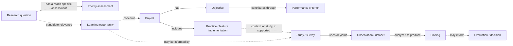

# Learning-opportunity conceptual model: review draft

- Updated: 2026-11-02. Status: analyst proposal for model review, grounded in existing artifacts; not an approved schema, ontology module, production link or FWWG workflow.
- Purpose: test what must be distinguishable when examining a priority research question against a restoration project and available evidence. The [Bertom linkage review](../goals/bertom-rock-habitat-linkage-review.md) provides the concrete test; [future practitioner prompts](../goals/fwwg-practitioner-story-prompts.md) are deferred.

## Working model

Solid and dashed paths are conceptual possibilities, not mandatory steps or assertions that every connection exists. Each relationship needs its own precise meaning and evidence; the diagram does not establish cardinality. In particular, a workshop mark is not an adopted opportunity, and a project's feature is not automatically a study treatment. The accepted [attributed linkage pattern](prospective-study-linkage-minimum-record.md) carries source or contributor, locator, scope, lifecycle and review state, and responsible role/system where known. It is not a physical record specification.

## Distinctions required by the test

| Concept | What it represents | Bertom test and boundary |
| --- | --- | --- |
| Question and priority assessment | A question is distinct from a particular reach/version ranking | WQ-39 is a local workbook reference; Upper Impounded rank 2 is an assessment, not confidence or a program-wide rank. The mark linking it to Bertom has unexplained meaning. |
| Candidate opportunity | A reviewable rationale for why a project may help explore a question | The analyst identifies a candidate connection; no FWWG selection or approved learning-opportunity criterion is documented. |
| Project, objective and criterion | A project has objectives and may have performance criteria | Historical mussel-bed objective and target are documented; EMMA criterion identity and target assessment are unverified. Existing EMMA objective–criterion and task–criterion relationships are many-to-many. |
| Practice, implementation and spatial representation | A practice idea, an installed or planned implementation, and a geometry/record are distinct | Seven named feature records are candidate channel-segment matches; the geometry and survey crosswalk are unverified. |
| Study/design, event and task | Planned design, collection activity and EMMA operational task are distinct | A 2014 survey is documented; the user confirms no EMMA task was recorded. A task must not be fabricated or required to represent the survey. |
| Observation, analysis and finding | Measured data, computation and author interpretation have different provenance | The report summarizes results; raw observations and analysis inputs were not located in this review. Reported site densities are not a channel-wide estimate. |
| Evaluation, assessment and decision | A criterion evaluation, objective judgment and later decision are separate | A reported scientific finding does not establish target attainment, causation or project success. |

Source/version/locator, temporal and spatial scope, review state and uncertainty qualify each link. A reproducible spatial relation, where needed, requires inputs, method, parameters and temporal alignment; proximity or overlap does not establish identity or exposure. Missing evidence limits only the inference that needs it.

## Organizational alignment and unresolved choices

Use the [reviewed USACE baseline](usace-ontology-alignment.md): document/provenance concepts for sources and attribution; planning concepts as candidates for objectives and plans; SOSA-style observation meanings for measurements; and existing spatial concepts for places and geometries. These are reuse candidates, not asserted equivalences. The local baseline's scoped scan did not establish existing concepts for all questions, findings or evidence relationships; further ontology review is needed before any extension.

Still open: which source owns each identity; feature/event identity and spatial history; the meaning and granularity of a learning-opportunity record; precise relationships and multiplicities beyond verified EMMA many-to-many links; whether and how to store link review history; and the methods a practitioner needs to compare evidence. No new controlled status list, database tables, identifiers, ontology terms, monitoring obligations or deployment are selected here.

## Review through a visualization

Use the [FWWG question-and-evidence prototype](../features/fwwg-question-evidence-prototype.md) to inspect the difference between priority, documented findings and unresolved links. It is a focused, source-based demonstration for discussion, not a prediction of what FWWG members want or proof of an approved framework. Defer user-story elicitation until practitioners have capacity.
