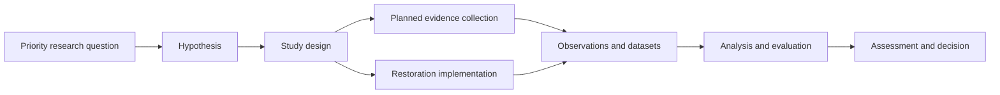

# Prospective study-linkage review

- Started: 2026-10-28
- Status: attributed-linkage minimum pattern accepted by the user for further validation on 2026-10-28; detailed connection meanings remain proposed; no new workflow, entity set, relationship identifier, ontology term, schema, or system-of-record assignment is approved
- Purpose: define the minimum durable connections that let scientists and restoration practitioners carry a science-driven restoration question from planning through later evaluation across staff turnover, project lifecycles, and the regional portfolio
- Basis: [project foundation](../goals/project-foundation.md), [requirements crosswalk](../goals/goals-requirements-crosswalk.md), [relationship analysis](science-restoration-relationships.md), [Steamboat conceptual-model review](steamboat-conceptual-model.md), [EMMA production review](production-schema-review.md), and [Restoration Features review](restoration-features-documentation-review.md)

## Scope and boundary

The user asked to work forward from studies, research questions, hypotheses, study designs, treatments and observations, while retaining working examples to test the result. This review focuses on the prospective planning middle:

This is a coordination path, not a mandatory linear sequence. A study can examine an existing practice, an HREP can be planned before a formal study exists, and later evidence can lead to a new question. The model must represent those arrangements, changes, and missing links without reporting them as failures.

The review does not replace the established EMMA chain of project objective → performance criterion → monitoring task → observation. It identifies how scientific planning may refer to or complement that chain. It also does not treat a general restoration practice, a planned feature, an installed feature, and a study treatment as interchangeable.

## Candidate connections to review

| Connection | Proposed meaning | Minimum durable record | Boundary to retain | Primary requirements to test |
| --- | --- | --- | --- | --- |
| Priority research question → hypothesis | A question motivates one or more explicitly attributed propositions that could be evaluated under stated conditions | Question identity and priority context; hypothesis wording, scope, originator/source, formulation date/version, review state and rationale for the linkage | Priority is not scientific confidence. A question is not a hypothesis, and an analyst formulation is not automatically an author or project proposition | R-02, R-09, R-13, R-16, R-17 |
| Hypothesis → study design | A design specifies how evidence is intended to bear on a proposition | Hypothesis reference; intended response(s); unit(s) of analysis; comparison or counterfactual; spatial/temporal scope; methods; relevant conditions; planned analysis/inference limit; design version and reviewer | A publication, dataset, or monitoring task is not itself necessarily a study design. One design may address several hypotheses, and one hypothesis may have several studies | R-03, R-07, R-09, R-15 |
| Study design → planned evidence collection | The design identifies data collection, data sources, analysis inputs and dependencies needed to execute it | Design reference; planned collection or existing data source; responsible partner; timing/frequency; sampling/method reference; data-management reference; planned/changed/performed/undocumented state and rationale | EMMA monitoring tasks may implement part of a scientific design, but task completion is not automatically an observation, analysis, or completed study | R-03, R-07, R-13, R-15, R-17 |
| Study design → restoration implementation | The design identifies the role of a practice or site-specific implementation in its comparison or interpretation | Design reference; role such as intervention, exposure, comparator, context, or candidate opportunity; practice/implementation reference; planned/actual state; place/time; defining characteristics; change/condition evidence | A broad practice is not a particular feature; a planned feature is not installed; an installed feature is not automatically an experimental treatment | R-03, R-08, R-10, R-11, R-15, R-17 |

These are relationship meanings and information needs. They are not proposed database fields, cardinalities, controlled values, user-interface steps, or a centralized review process.

## Existing-system anchors and responsibility boundary

| Information need | Existing or candidate anchor | Review boundary |
| --- | --- | --- |
| Project, objective, performance criterion, monitoring task and task event | EMMA production records and their documented many-to-many objective/criterion and task/criterion relationships | Preserve EMMA as system of record for established project/monitoring commitments. Inspect live observation storage and operating practice before assigning a new integration responsibility |
| Planned/installed restoration practice, feature classification, geometry and selected lifecycle information | Restoration Features production GIS and source design/as-built artifacts | Preserve practice, implementation, geometry and condition distinctions. Do not infer an EMMA join from matching field names or create an implementation record from a general practice label |
| Research question priority context | Workshop artifacts and future program sources | Retain edition, reach/context and source. Do not turn a workshop ranking or project mark into a scientific test or design commitment |
| Hypothesis, study design, evidence plan, analysis and applicability reasoning | Candidate science and restoration integration records linked to partner-owned sources | Establish minimum stewardship, review and handoff needs only after examining existing partner workflows. This review does not assign a system of record |
| Research outputs, datasets and source passages | ScienceBase, publications, source holdings and external catalogues | Retain stable references, version/locator and access state. Reference external data at useful granularity; do not require wholesale data ingestion |

## Steamboat test of the proposed connections

Steamboat is deliberately incomplete. It tests whether the model records what is documented, what is proposed, and what remains unknown without fabricating a completed science–restoration chain.

| Connection | Available pilot evidence | What the model must record as unresolved |
| --- | --- | --- |
| Priority question → hypothesis | Workshop WQ-39 provides a mussel/substrate learning context; SC-08 is an assistant-formulated proposition informed by reviewed science records | WQ-39 does not establish adoption of SC-08. SC-08 is not an approved project hypothesis or a statement that Steamboat was designed to test it |
| Hypothesis → study design | MS-03 supplies an observational core/periphery study with partial source-to-data trace | MS-03 was not designed as a Steamboat treatment study; full fitted-model and method details remain unverified; local transfer requires an applicability judgment |
| Study design → planned evidence collection | The user reports baseline and construction monitoring; the reviewed feasibility material does not locate a dedicated mussel monitoring commitment | Whether existing monitoring could supply relevant evidence, which partner owns it, and what additional collection/comparison would be needed are unresolved |
| Study design → restoration implementation | The feasibility report documents an anticipated ancillary mussel-habitat benefit associated with stone protection | Specific planned/installed Restoration Features identity, condition, timing and role in an evaluable design are unresolved; no installation or treatment effect is inferred |

The result is useful even without a completed comparison: it identifies the smallest follow-up artifacts needed to make a local evaluation possible, while preserving science that can inform planning now.

## Review questions for the next discussion

1. Is a **hypothesis** the smallest independently reviewable scientific proposition, or are some expected benefits/design rationales sufficiently different to require a separate meaning?
2. Which design components are indispensable for a later reviewer to understand the intended inference, and which should remain discipline-specific attachments or external references?
3. When a planned collection uses an EMMA monitoring task, what cross-reference and lifecycle evidence are sufficient to show the relationship without duplicating EMMA data?
4. Which roles for a restoration implementation are needed at minimum: intervention, exposure, comparator, context and candidate opportunity; and should these remain an attributed relationship rather than a fixed classification of the feature?
5. What is the lightest sustainable stewardship/review practice that preserves these links through partner and staff transitions?

## Test record and next review

The [Steamboat prospective study-linkage record](../goals/steamboat-prospective-study-linkage.md) now tests these proposed meanings using available artifacts. It includes one question, attributed hypothesis, existing study/design, local design gap, planned/existing evidence collection, restoration implementation role, sources, review state and unresolved links. It is a test of usability and maintenance burden, not a new required project form or a production data-entry workflow.

The [minimum-record assessment](prospective-study-linkage-minimum-record.md) records the accepted working pattern and its stewardship limits. The next validation should apply that pattern to one deliberately contrasting artifact situation. No relationship identifier, ontology extension, EMMA change, Restoration Features change, database implementation, or new monitoring obligation follows from this test alone.

