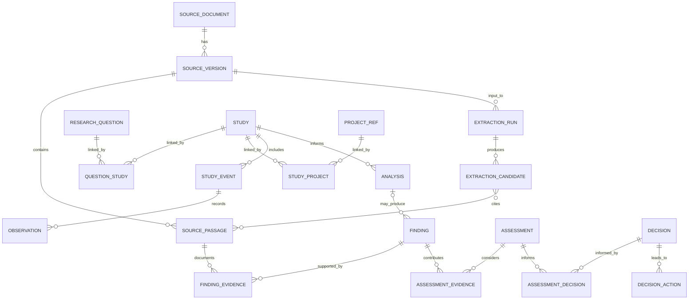

# Relational model and document-extraction roadmap

Updated 2026-11-05. Status: **user-directed design direction and proposed logical model**, not approved table definitions, DDL, Oracle deployment or a new application. This document translates the [data model design report](data-model-design-report.md) into a developer-reviewable starting point. Validate against production EMMA exports, Restoration Features, the [USACE ontology alignment](usace-ontology-alignment.md), domain experts and deployers before defining a physical schema.

**MVP priority update:** the user wants a feasible working demonstration for partner review and ROI evaluation before detailed adjudication/change-control processes or extraction-quality benchmarking. Preserve those as future requirements; source attribution and clearly provisional status remain useful in the MVP. The expanded [domain ERD and dictionary](relational-vertical-slice.md) are the current design focus; the detailed validation and evaluation procedures below are future options, not MVP gates.

## Direction and boundaries

The user identifies EMMA as an application in a USACE enterprise AWS-hosted Oracle APEX environment, and wants enterprise deployment of the eventual integration component as the end goal. Oracle is the **probable target**, not confirmation of a specific database version, infrastructure configuration, access path, schema ownership or deployment authorization. Model the domain explicitly as entities, relational tables and constraints suitable for review in an ERD; do not require Oracle SQL object types merely because the user said object-relational. Confirm enterprise terminology and native features with deployers.

Front-load the logical model, identifiers, boundaries, evidence and governance. The user selected **DuckDB for local R-first development**, superseding the earlier PostgreSQL direction; PostgreSQL remains a potential later target. Deployment and Oracle compatibility remain open. Existing JSON files are interim reviewed extraction artifacts and prototype inputs, not the authoritative future relational contract. Preserve and trace them during transition. See the [relational vertical slice](relational-vertical-slice.md), [DuckDB prototype and migration crosswalk](duckdb-mvp-and-emma-migration.md) and [extraction quality plan](extraction-quality-and-reprocessing.md).

The user intends retrieval-augmented generation (RAG) and LLM assistance to extract information from historical program documents and scientific literature and support subsequent analysis. Design for retrieval as part of the pipeline without assuming a vector index, model vendor, hosted service or automated acceptance. When a specific source passage is already known, direct passage-based extraction is also a useful baseline to compare against retrieval; both must meet the same provenance and review requirements.

## First logical model: entities and relationships

The diagram shows a **proposed logical skeleton**, not a complete physical ERD. A line denotes a possible relationship and does not itself establish scientific support or enforce a required project-to-decision sequence. Existing EMMA entities are shown as external anchors; their physical keys and ownership must be confirmed before integration. Relationship attributes and alternative designs are detailed below.

Mermaid's implicit many-to-many line between extraction candidates and source passages represents a **junction table** in a relational implementation, not an array column. All `||` in this sketch mean the child refers to a parent *when that child record exists*; they do not require every study to have a question, every project a study, every finding a formal assessment, or every historical observation a recorded EMMA monitoring task. The optional analysis relationship allows source-reported findings without a reconstructed analysis or raw observation. Cardinalities and parent optionality are review questions; do not generate DDL from this diagram without resolving them. Candidates may also cite source versions, locations or provenance not modeled in this simplified sketch.

| Proposed table family | Candidate contents and constraints to review | Design cautions |
| --- | --- | --- |
| `SOURCE_DOCUMENT`, `SOURCE_VERSION`, `SOURCE_PASSAGE` | Stable document identity; version/fingerprint and acquisition metadata; passage locator, page/section and extraction method. One document can have multiple versions and each version multiple passages. | Passage text and file storage permissions need program review. OCR and page/printed-page locators must retain limitations. |
| `EXTRACTION_RUN`, `EXTRACTION_CANDIDATE`, `CANDIDATE_PASSAGE`, `CANDIDATE_REVIEW` | Run configuration, source version, model/prompt/index version where applicable; typed candidate, source passages, status, reviewer and review actions. Use junction tables for multiple passages. | Proposed staging concept; extraction output is not automatically an authoritative entity or relationship. Record disagreements, rejection and correction without erasing history. Candidate payload representation and mapping to typed staging tables are unresolved; avoid making a JSON blob the durable domain model. |
| `RESEARCH_QUESTION`, `HYPOTHESIS`, `STUDY`, `QUESTION_STUDY` | Separate question and proposition; study and design/version as warranted; many-to-many question–study relationship with precise role and attribution. | A later relevance link is not evidence of original study intent. A study can address a question without a formal hypothesis. Distinguish a study from a publication or dataset. |
| `PROJECT_REF`, `FEATURE_REF`, `STUDY_PROJECT`, `STUDY_FEATURE` | References to EMMA project and Restoration Features records; typed, attributed links to studies and features, with time/scope and status. | Names are integration placeholders, not instructions to duplicate the production systems. Preserve external IDs and source systems; a project-ID match is not proof of feature identity or spatial exposure. Existing EMMA objective–criterion and task–criterion many-to-many structures must be retained. |
| `STUDY_EVENT`, `OBSERVATION`, `DATASET_REF`, `ANALYSIS` | Distinguish a study execution, sampling event, measurement, dataset and analysis; use junctions where actual evidence indicates multiple sources or inputs. | Survey results may be known only at report level. Do not invent a monitoring task, individual measurement or dataset to complete the chain. |
| `FINDING`, `ASSESSMENT`, `DECISION`, `DECISION_ACTION` | Distinct source-reported or practitioner-authored scientific findings, evidence/criterion assessments, decisions including deferral, and follow-up actions. Separate junctions preserve supporting and contrary evidence and decision basis. | A finding can exist without an analysis record; an assessment may need multiple findings and criteria; a decision can refer to multiple assessments. One must not imply another was completed. |
| `AGENT`, `CONTRIBUTION`, `REVIEW_EVENT`, `RECORD_VERSION` | Candidate patterns for attribution, role, review and revision, including agent type, responsibility, valid/recorded time and supersession. | Whether these are shared tables, per-domain tables, or enterprise audit services is unresolved. Preserve prior versions and distinguish automated attribution from practitioner authorship. |

The table names above are design labels, not approved production names. The diagram omits objective/criterion junctions, hypotheses, datasets, features, many evidence links and temporal/spatial details to stay readable; the table family list and conceptual report retain them. In the next logical-model iteration, represent relationship-specific foreign keys and association tables explicitly, including attribution and provenance. Avoid one untyped global `subject_id` / `object_id` table unless an enforceable relational supertype and its integrity tradeoffs are deliberately reviewed.

## Cross-case design checks

1. **Bertom:** store the 2015 report and source version/passage; the 2014 survey and source-reported results can exist without raw observations or an EMMA task. WQ-39's later proposed relevance and the candidate project/GIS associations have separate relation types and evidence. A hypothetical assessment stays marked synthetic and is not a real decision.
2. **Steamboat:** an ancillary mussel benefit, externally sourced science, proposed local hypothesis and possible study are different objects; do not create an adopted hypothesis, implemented feature, observed effect or formal criterion where no evidence supports one.
3. **Disagreement and evolution:** multiple attributed statements can address the same proposition, sources may support or challenge them, and later assessments or decisions can revise earlier ones without deleting provenance.
4. **Existing anchors:** retain EMMA's documented objective–criterion and task–criterion many-to-many associations and source-system authority. Link a study location and a restoration feature through a documented spatial method, tolerance and temporal scope when available; spatial proximity does not establish causation.

## Portable prototyping and Oracle handoff

Use **DuckDB** for the development prototype, as directed by the user. Do not assume DuckDB is wire- or SQL-compatible with Oracle or PostgreSQL. Keep SQL and fixtures versioned, database files and sensitive originals out of Git unless specifically approved, and distinguish synthetic/curated examples from production data. Record engine and version, initialization and reproducible validation commands. A local prototype is not a production deployment or substitute for enterprise review.

Use portable primary/foreign keys, junctions, unique and check constraints where possible; document dialect-specific data types, key generation, null/empty-string behavior, timestamps, text sizes, spatial support, indexing, audit history, access control and migration strategy. Oracle documents different empty-string/null behavior and enforces database constraints; [Oracle nulls](https://docs.oracle.com/en/database/oracle/oracle-database/19/sqlrf/Nulls.html), [Oracle table constraints](https://docs.oracle.com/en/database/oracle/oracle-database/19/tdddg/creating-and-managing-tables.html). Confirm target version and APEX/enterprise conventions before producing vendor DDL or claiming portability.

The handoff to database developers should eventually include a logical ERD, entity/attribute dictionary, primary and foreign keys, relationship cardinalities and optionality, provenance and review rules, source-system crosswalk, sample queries/fixtures, migration and dialect notes, and unresolved decisions. Produce Oracle-specific physical DDL and deployment artifacts only after target-team review.

## Retrieval and extraction pipeline

1. **Register and prepare sources:** inventory and version documents; retain identity, source, hash and permissions; extract/OCR with page, section, table and coordinates where possible. Track extraction errors and document coverage.
2. **Retrieve candidate evidence:** index permitted text and metadata; search by document, project, question, time and terminology. Compare lexical and semantic retrieval, including hybrid approaches, against known passages. Record index/corpus version, query, filters and returned passages. Retrieval results are leads, not proof of corpus completeness.
3. **Propose typed records:** give the model a bounded task and evidence passages; output typed candidates and explicit relations with source locator, quoted or otherwise verifiable span, uncertainty and model/prompt/run versions. Intermediate JSON is acceptable as a transport format; validate and map it into typed relational staging records.
4. **Validate and review:** check structure, foreign keys, identity candidates, source-span support, relation direction, scope, negation, time and missingness. A reviewer accepts, rejects, corrects or defers candidates and records their decision. Preserve both original extraction and review history; promotion to authoritative records follows agreed stewardship and permissions.
5. **Analyze and report:** query reviewed relational records and their typed links; optionally retrieve supporting passages for explanation. Clearly distinguish evidence, interpretation, missing records and generation. Reports must expose provenance and not turn an unlocated document into a negative finding.

RAG connects retrieval with model generation; it does not by itself establish correct extraction, complete retrieval, verified sources, authorization or review. See [Lewis et al. 2020](https://arxiv.org/abs/2005.11401) and the [RAG failure-point study](https://arxiv.org/abs/2401.05856). Internal-document access, model hosting and use of external providers require the actual enterprise's approved data-handling decisions; no provider or deployment has been selected.

## Next bounded modeling increment

The **logical ERD and data dictionary** in the [relational vertical slice](relational-vertical-slice.md) include core questions, hypotheses, objectives, criteria, assessments and decisions, as well as evidence and study objects. A bounded [DuckDB schema and curated fixture](duckdb-mvp-and-emma-migration.md) now implement the local slice. Next, connect the model to an extraction and report demonstration. Keep records attributable and clearly provisional. The separate [quality and reprocessing plan](extraction-quality-and-reprocessing.md), benchmark comparisons and formal review controls remain on hold for partnership design and later evaluation.

This roadmap does not authorize database deployment, production changes, ingestion of restricted material into external services or any claim that a system is complete. The user has requested rigorous front-loaded design; implementation and enterprise acceptance are later steps.
