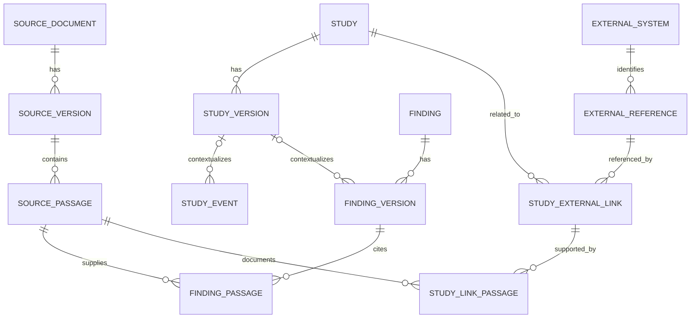
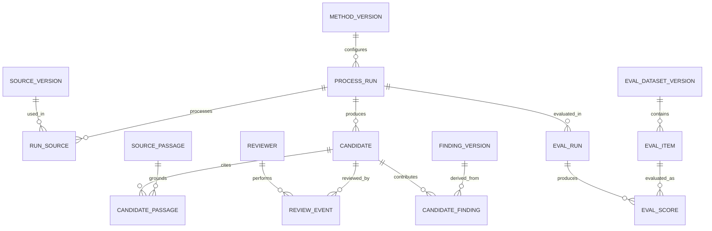

# Relational vertical slice: sources, claims and review

Updated 2026-11-05. Status: **proposed logical model for review**. PostgreSQL is the user-selected development database; the intended enterprise target is the existing USACE Oracle APEX environment, with exact Oracle version and conventions unconfirmed. This is not executable DDL, an approved schema, an operational system or authorization to connect to production. Names and cardinalities are design proposals, checked against the [Bertom case](../goals/bertom-three-entry-model-test.md), [Steamboat prospective record](../goals/steamboat-prospective-study-linkage.md) and [existing EMMA review](production-schema-review.md).

## Design boundaries

The slice must represent source-reported findings even when no raw measurements, EMMA task, analysis, feature match or decision is recoverable. A proposed relation or extraction remains distinct from a fact reviewed for use. Project and feature references identify records owned elsewhere; they do not replicate or override the production system. Objectives, criteria, hypotheses, decisions, full spatial semantics and measurements remain outside this increment except as future extensions. In particular, this slice does not replace EMMA's documented many-to-many objective–criterion and task–criterion relationships.

`PK` = primary key; `FK` = foreign key; `UQ` = unique constraint; `NN` = not null; `?` = optional. Logical types below describe meaning; physical lengths, generated-key strategy, encodings, timestamp precision, indexes and Oracle equivalents await developer review. Single-column IDs are surrogate identifiers local to this proposed integration model, not production or public identifiers. Use `ON DELETE RESTRICT` or equivalent for referenced evidence/history; archival policy remains open. Authoritative-source identifiers, locators and exact original wording must not be overwritten by normalization.

## ERD: source and evidence

Crow's-foot cardinalities state the proposed relationship for this slice. Every child FK shown is NN unless a field dictionary says otherwise. A parent having zero children does not imply evidence or a task never existed. `FINDING_VERSION` is a *record of a finding*, including source-reported aggregate results; it is not necessarily a raw observation or assessment.

`STUDY_EVENT`'s optional version FK allows a documented field event to exist when the formal study/design is unresolved. Both `FINDING_VERSION.study_version_id` and `STUDY_EVENT.study_version_id` are optional; the model does not invent an analysis or task. A study may be connected to several external references and vice versa. No line means causal, identity or evidentiary support unless its typed relation and reviewed source actually say so.

### Source and domain dictionary

| Table | Proposed fields and constraints | Meaning and review questions |
| --- | --- | --- |
| `source_document` | `document_id` PK; `title` NN; `document_type`?; `issuing_body`? | Intellectual document identity, distinct from its versions. External catalog identifiers need a separate identifier table if there can be multiple. |
| `source_version` | `source_version_id` PK; `document_id` FK NN; `version_label`?; `sha256` NN; `source_uri`?; `publication_date`?; UQ (`document_id`,`sha256`) | The exact acquired file/edition. A hash identifies bytes, not factual correctness; multiple copies/URIs may later need a junction. File storage and access policy are open. |
| `source_passage` | `passage_id` PK; `source_version_id` FK NN; `locator` NN; `extracted_text`?; `extraction_method`?; `extraction_quality`? | Page, section, table or other locator in that version. Locator uniqueness is **not** assumed; keep printed/PDF page distinctions in the locator and later structured columns. Passage text can be unavailable or restricted. |
| `study`, `study_version` | `study_id` PK; `study_version_id` PK; `study_id` FK NN; `version_no` NN; `title` NN; `description`?; UQ (`study_id`,`version_no`) | Stable identity and revisable description of a research or monitoring study. A report is not automatically the study. Rules for version creation and current version require implementation design. |
| `study_event` | `event_id` PK; `study_version_id` FK?; `description` NN; `start_date`?; `end_date`?; `date_precision`? | A documented event, not an EMMA task. Dates may be partially known; enforce start ≤ end only when both are present and compatible. Location and methods need future typed structures. |
| `finding`, `finding_version` | `finding_id` PK; `finding_version_id` PK; `finding_id` FK NN; `version_no` NN; `study_version_id` FK?; `finding_text` NN; `finding_type` NN; `authorship_status` NN; `created_at` NN; UQ (`finding_id`,`version_no`) | A versioned source-reported or practitioner-authored finding; distinguish source authorship from extractor/reviewer. This slice requires an evidence link for a reviewed source-reported finding as a **workflow validation**, not a SQL `NOT NULL` on a child junction. |
| `finding_passage` | `finding_version_id` FK NN; `passage_id` FK NN; `evidence_role` NN; `rationale`?; PK (`finding_version_id`,`passage_id`,`evidence_role`) | Allows multiple sources and support/challenge/context roles, attributed through review/provenance. A citation is not automatically empirical support or a criterion assessment. |
| `external_system`, `external_reference` | `system_id` PK; `system_name` NN UQ; `external_ref_id` PK; `system_id` FK NN; `entity_kind` NN; `native_id` NN; `namespace` NN; UQ (`system_id`,`namespace`,`entity_kind`,`native_id`) | A reference and namespace, not a new EMMA project or GIS feature. Namespace is required because the supplied GIS export includes identifier reuse across classes; its actual enterprise semantics require steward confirmation. |
| `study_external_link` | `link_id` PK; `study_id` FK NN; `external_ref_id` FK NN; `relationship_type` NN; `scope_note`?; `valid_from`?; `valid_to`?; `review_state` NN; `created_at` NN | A typed, attributed association, not a generic untyped graph edge. The appropriate relation and revision strategy are open; avoid UQ on endpoints alone because different roles, times and competing interpretations may coexist. |
| `study_link_passage` | `link_id` FK NN; `passage_id` FK NN; `role` NN; PK (`link_id`,`passage_id`,`role`) | Evidence for or context of the association. An analyst-proposed link can remain provisional without an evidence passage; do not treat this absence as absence of a real relation. |

`review_state` above is an illustrative domain state, not the source of truth for an audit trail. A later physical design must specify how it is derived from or synchronized with append-only review history; do not allow an unrestricted update to erase who decided what and when. Use lookup tables or governed reference data for types/statuses; values, transition rules and responsible roles need practitioner and enterprise review.

## ERD: extraction and quality assessment

This model supports multiple document versions, extraction methods, runs, review decisions and evaluations over time. **A candidate is not a finding**. The proposed `candidate_finding` bridge records exactly which accepted candidate contributed to a particular finding version; its existence must not itself confer acceptance.

| Table | Proposed fields and constraints | Meaning and review questions |
| --- | --- | --- |
| `method_version` | `method_version_id` PK; `method_kind` NN; `name` NN; `version_label` NN; `config_uri`?; `config_hash`?; `model_id`?; `prompt_id`?; `code_revision`?; UQ (`method_kind`,`name`,`version_label`) | A versioned method/adapter; retrieval, OCR, extraction and evaluation can evolve independently. A multi-stage pipeline requires run lineage rather than assuming one model describes everything. Version fields are identifiers, not proof of reproducibility. |
| `process_run` | `run_id` PK; `method_version_id` FK NN; `started_at` NN; `completed_at`?; `run_status` NN; `random_seed`?; `environment_ref`? | One execution, including failed/partial runs. Add an explicit run-dependency junction for preparation → indexing → retrieval → extraction; capture provider/model revision where available and restrictions on recording prompts or data. |
| `run_source` | `run_id` FK NN; `source_version_id` FK NN; `input_role` NN; PK (`run_id`,`source_version_id`,`input_role`) | Many documents can be processed in one run and one version in many runs. Retrieval index/corpus membership and query/results need separate versioned tables in a later slice. |
| `candidate` | `candidate_id` PK; `run_id` FK NN; `candidate_kind` NN; `candidate_text` NN; `confidence_value`?; `confidence_method`?; `created_at` NN | A proposed extraction, with original output and uncertainty. Scores are model/tool-specific and not automatically calibrated probabilities. Typed candidate relations and non-text attributes require domain-specific staging tables before implementation; do not invent polymorphic foreign keys. |
| `candidate_passage` | `candidate_id` FK NN; `passage_id` FK NN; `evidence_role` NN; `span_locator`?; PK (`candidate_id`,`passage_id`,`evidence_role`) | Links a candidate to source evidence. Passage may be unsupported or a run may produce a candidate without one; this is a review failure/deferral, not a fabricated citation. Preserve reported versus independently verified locators. |
| `reviewer`, `review_event` | `reviewer_id` PK; `reviewer_type` NN; `display_name` NN; `review_event_id` PK; `candidate_id` FK NN; `reviewer_id` FK NN; `outcome` NN; `rationale`?; `reviewed_at` NN | Repeatable independent human or automated review, disagreement, correction and adjudication. Exact user identity, authentication, reviewer independence and data access integrate with enterprise services later. Automated evaluation must not masquerade as practitioner approval. |
| `candidate_finding` | `candidate_id` FK NN; `finding_version_id` FK NN; `derivation_role` NN; PK (`candidate_id`,`finding_version_id`,`derivation_role`) | Provenance of accepted/corrected material. Admission must be checked against appropriate human review, source evidence and identity reconciliation; the junction FK alone cannot enforce that policy. One candidate can contribute to more than one version and vice versa. |
| `eval_dataset_version`, `eval_item` | `eval_dataset_version_id` PK; `dataset_name` NN; `version_label` NN; `annotation_guideline_version` NN; UQ (`dataset_name`,`version_label`); `eval_item_id` PK; `eval_dataset_version_id` FK NN; `source_version_id` FK NN; `task_type` NN; `split_label` NN | Immutable benchmark edition and source-grounded cases. Reference annotations, annotators, adjudication, passage-level labels, negative cases and evidence spans require child tables in the detailed evaluation model; do not treat one label as unquestionable truth. Splits must group related versions and passages to prevent leakage. |
| `eval_run`, `eval_score` | `eval_run_id` PK; `run_id` FK NN; `eval_dataset_version_id` FK NN; `evaluator_method_version_id` FK NN; `started_at` NN; `eval_score_id` PK; `eval_run_id` FK NN; `eval_item_id` FK NN; `metric_name` NN; `metric_value`?; `numerator`?; `denominator`?; `error_category`? | Per-item outcomes and diagnostics, with aggregate reporting derived from them. Ensure `eval_item` belongs to the dataset edition referenced by `eval_run` using composite FKs or an equivalent enforced rule. A zero denominator must remain undefined, not silently recorded as zero. Evaluation may use human labels or tools; record which. |

**Review integrity:** each `review_event` is append-only in the proposed workflow; corrections create a later event and a new candidate or finding version linked to its predecessor. Human accept, reject, correct and defer are distinct events; multiple reviewer disagreements and an adjudication must remain visible. A transaction should promote an accepted candidate and link its source and review trail atomically. The precise schema for linking a specific review decision to a promotion, authorization rules, reversals and exception handling is an **open design requirement**, not yet enforced by the displayed tables. A production system must explicitly close this gap before promotion is enabled.

## Worked conceptual rows

These are illustrations of relationships, not a migration, a validated SQL fixture or new production records. Source locators and exact wording remain in the linked case reviews.

| Case | Proposed rows and links | What must remain unknown |
| --- | --- | --- |
| Bertom 2014 survey | A 2015 `source_version` and located `source_passage`; a `study_event` for 7–9 October 2014; a `finding_version` reporting 40 live mussels and 11 species across the channel methods; `finding_passage` to the supporting report passage. | No EMMA monitoring task or raw observation is created. The finding's study version is optional until identity and design are established; the aggregate is not a set of individual observations. |
| Bertom project/feature | A `study_external_link` may record a proposed association to an external reference, with passage, role and review state. A GIS segment is a separate `external_reference` with its source-system namespace. | Project ID 65 in two exports is a candidate association, not validated EMMA identity; individual survey-to-feature spatial relation remains unverified. WQ-39 relevance is a later candidate and is outside this slice's relationship table. |
| Steamboat | A source passage for the ancillary mussel benefit and a candidate record capture the source statement and extraction run; a `review_event` can preserve a future expert's acceptance or correction. | SC-08 is an assistant-formulated proposition, not designer adoption; no local effect or formal mussel criterion follows. A real reviewer and review outcome are not invented. |
| Reprocessing | A new `source_version` for changed bytes or a new `method_version` produces a separate `process_run` and separate candidates; link reviewed changes to prior records through a later defined version/supersession mechanism. | An updated source does not automatically invalidate every historical finding, and unchanged document bytes do not prove unchanged scientific interpretation. |

**Synthetic review stress test:** imagine two reviewers disagree whether the Bertom report is adequate to support a proposed statement about historical target attainment. Store their independent `review_event` outcomes and rationales, then a separate adjudication if one occurs; retain each event. A hypothetical insufficient-evidence *assessment* cannot yet be represented as a first-class `assessment` in this slice: that is an identified extension, not permission to mislabel it as a scientific finding. A later decision or deferral likewise needs its own model and responsible actor. These examples are hypothetical and make no actual practitioner judgment.

`authorship_status` alone does not identify a named author: a typed, many-to-many contribution/agent record and source-specific authorship remain required extensions before the model can satisfy the full attribution requirement. Similarly, `review_state` on a link is insufficient by itself to prove who evaluated that specific association; an attributed link-review history is required. These gaps prevent treating the slice as production-ready.

## PostgreSQL development and Oracle handoff

PostgreSQL is the selected development engine. Keep schema migrations, synthetic/curated fixtures, configuration templates and validation queries in version control; use a disposable local database and keep credentials and restricted source material out of the repository. A reproducible setup still requires selecting supported PostgreSQL version, provisioning method, migration tool and R database driver; those choices are not made here. PostgreSQL offers primary, unique and foreign-key constraints, but syntactic and semantic differences must be reviewed with Oracle implementers. [PostgreSQL constraints](https://www.postgresql.org/docs/current/ddl-constraints.html); [Oracle data integrity](https://docs.oracle.com/en/database/oracle/oracle-database/19/cncpt/data-integrity.html).

Before implementation settle database version, schema ownership, permission boundary, source-system integration and whether target Oracle APEX uses enterprise audit/revision services. Compare key-generation, timestamps, nullable unique keys, empty strings, text limits, spatial types and transactional behavior. Do not infer automatic portability from an ERD. Do not require production access to build the local slice.

## Open decisions and next implementation boundary

- Source-version identity and duplicate copies; required source locators and passage granularity; file rights and retention.
- Domain-specific candidate relation staging and how each candidate kind maps to reviewed, versioned domain tables.
- Enforceable linkage from promotion to a specific accepted/adjudicated review, its evidence, responsible reviewer and reversal/supersession history.
- Reviewer identities and separation of human decisions from automated judgments; shared enterprise audit services.
- Versioning and identity reconciliation for studies, findings and attributed relations, including concurrent contradictory views.
- Full research question, hypothesis, assessment, criterion, decision, observation and spatial models, preserving EMMA's existing junctions.
- Evaluation reference annotation, leakage-proof splits, evolving metric definitions and version-specific baselines.

The next increment should review this logical slice with database and science stakeholders, then implement a small PostgreSQL schema and fixtures with explicit validation queries. Physical DDL should not be described as Oracle-ready until deployers check the actual environment. See the [extraction quality and reprocessing plan](extraction-quality-and-reprocessing.md).
