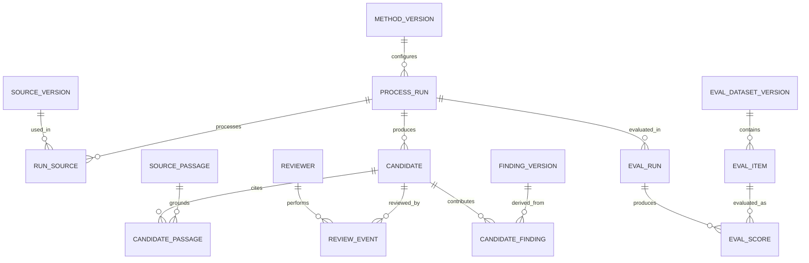

# Relational vertical slice: sources, claims and review

Updated 2026-11-05. Status: **proposed logical model for review**. The user selected DuckDB for local R-first development, superseding PostgreSQL; the intended enterprise target is the existing USACE Oracle APEX environment, with exact Oracle version and conventions unconfirmed. This document is not approved enterprise DDL or authorization to connect to production. The [DuckDB MVP and migration crosswalk](duckdb-mvp-and-emma-migration.md) documents the implemented local subset. Names and cardinalities are design proposals, checked against the [Bertom case](../goals/bertom-three-entry-model-test.md), [Steamboat prospective record](../goals/steamboat-prospective-study-linkage.md) and [existing EMMA review](production-schema-review.md).

**MVP direction:** The user requested the domain objects below as the present priority. Capture source attribution and label machine-extracted material as proposed in the prototype. Detailed adjudication, promotion/change control, evaluation methods and quality thresholds are important requirements **on hold for partnership design after a reviewable MVP**; the candidate review/evaluation diagram further below is exploratory, not an implementation gate or prescribed partnership workflow.

The newer [research question and evidence extension](research-questions-evidence-relational-design.md) refines this slice with multi-source question/hypothesis evidence, direct provisional project links, workshop context and reconciliation of WQ-39 and SC-08. It accommodates non-workshop sources and records implementation limits.

## Design boundaries

The slice must represent source-reported findings even when no raw measurements, EMMA task, analysis, feature match or decision is recoverable. A proposed relation or extraction remains distinct from a fact reviewed for use. Project and feature references identify records owned elsewhere; they do not replicate or override the production system. Research questions, hypotheses, objectives, criteria, assessments and decisions are now included as proposed logical objects. Full spatial semantics, measurements and formal review workflows remain outside the slice. This model does not replace EMMA's documented many-to-many objective–criterion and task–criterion relationships.

`PK` = primary key; `FK` = foreign key; `UQ` = unique constraint; `NN` = not null; `?` = optional. Logical types below describe meaning; physical lengths, generated-key strategy, encodings, timestamp precision, indexes and Oracle equivalents await developer review. Single-column IDs are surrogate identifiers local to this proposed integration model, not production or public identifiers. Use `ON DELETE RESTRICT` or equivalent for referenced evidence/history; archival policy remains open. Authoritative-source identifiers, locators and exact original wording must not be overwritten by normalization.

## ERD: source and evidence

Crow's-foot cardinalities state the proposed relationship for this slice. Every child FK shown is NN unless a field dictionary says otherwise. A parent having zero children does not imply evidence or a task never existed. `FINDING_VERSION` is a *record of a finding*, including source-reported aggregate results; it is not necessarily a raw observation or assessment.

```mermaid
erDiagram
  SOURCE_DOCUMENT ||--o{ SOURCE_VERSION : has
  SOURCE_VERSION ||--o{ SOURCE_PASSAGE : contains
  SOURCE_PASSAGE o|--o{ RESEARCH_QUESTION : documents
  SOURCE_PASSAGE o|--o{ HYPOTHESIS : documents
  SOURCE_PASSAGE o|--o{ PROJECT_OBJECTIVE : documents
  SOURCE_PASSAGE o|--o{ PERFORMANCE_CRITERION : documents
  SOURCE_PASSAGE o|--o{ ASSESSMENT : documents
  SOURCE_PASSAGE o|--o{ DECISION : documents
  SOURCE_PASSAGE o|--o{ STUDY_EVENT : documents
  RESEARCH_QUESTION ||--o{ QUESTION_HYPOTHESIS : linked_by
  HYPOTHESIS ||--o{ QUESTION_HYPOTHESIS : linked_by
  RESEARCH_QUESTION ||--o{ QUESTION_STUDY : linked_by
  STUDY ||--o{ QUESTION_STUDY : linked_by
  HYPOTHESIS ||--o{ HYPOTHESIS_STUDY : linked_by
  STUDY ||--o{ HYPOTHESIS_STUDY : linked_by
  PROJECT_OBJECTIVE ||--o{ OBJECTIVE_CRITERION : linked_by
  PERFORMANCE_CRITERION ||--o{ OBJECTIVE_CRITERION : linked_by
  MONITORING_TASK_REF ||--o{ TASK_CRITERION : linked_by
  PERFORMANCE_CRITERION ||--o{ TASK_CRITERION : linked_by
  STUDY ||--o{ STUDY_VERSION : has
  STUDY_VERSION o|--o{ STUDY_EVENT : contextualizes
  FINDING ||--o{ FINDING_VERSION : has
  STUDY_VERSION o|--o{ FINDING_VERSION : contextualizes
  FINDING_VERSION ||--o{ FINDING_PASSAGE : cites
  SOURCE_PASSAGE ||--o{ FINDING_PASSAGE : supplies
  ASSESSMENT ||--o{ ASSESSMENT_FINDING : considers
  FINDING_VERSION ||--o{ ASSESSMENT_FINDING : contributes
  ASSESSMENT ||--o{ ASSESSMENT_CRITERION : evaluates
  PERFORMANCE_CRITERION ||--o{ ASSESSMENT_CRITERION : evaluated_in
  ASSESSMENT ||--o{ ASSESSMENT_DECISION : informs
  DECISION ||--o{ ASSESSMENT_DECISION : informed_by
  DECISION ||--o{ DECISION_ACTION : may_lead_to
  EXTERNAL_SYSTEM ||--o{ EXTERNAL_REFERENCE : identifies
  EXTERNAL_REFERENCE o|--o{ PROJECT_OBJECTIVE : identifies_project
  EXTERNAL_REFERENCE o|--o{ PROJECT_OBJECTIVE : identifies_emma_objective
  EXTERNAL_REFERENCE ||--o{ PROJECT_OBJECTIVE_LINK : candidate_project
  PROJECT_OBJECTIVE ||--o{ PROJECT_OBJECTIVE_LINK : candidate_objective
  EXTERNAL_REFERENCE o|--o{ PERFORMANCE_CRITERION : identifies_emma_criterion
  EXTERNAL_REFERENCE ||--o{ MONITORING_TASK_REF : identifies
  STUDY ||--o{ STUDY_EXTERNAL_LINK : related_to
  EXTERNAL_REFERENCE ||--o{ STUDY_EXTERNAL_LINK : referenced_by
  STUDY_EXTERNAL_LINK ||--o{ STUDY_LINK_PASSAGE : supported_by
  SOURCE_PASSAGE ||--o{ STUDY_LINK_PASSAGE : documents
```

`STUDY_EVENT`'s optional version FK allows a documented field event to exist when the formal study/design is unresolved. Both `FINDING_VERSION.study_version_id` and `STUDY_EVENT.study_version_id` are optional; the model does not invent an analysis or task. A study may be connected to several external references and vice versa. No line means causal, identity or evidentiary support unless its typed relation and source actually say so. Junctions require both endpoints when a row exists, but no endpoint requires a junction row: a decision need not have a recorded assessment; a question need not have a hypothesis; a criterion need not have a monitoring task. The two EMMA junctions are conceptual mirrors of existing relationships, not proposed replacement production tables.

### Source and domain dictionary

| Table | Proposed fields and constraints | Meaning and review questions |
| --- | --- | --- |
| `source_document` | `document_id` PK; `title` NN; `document_type`?; `issuing_body`? | Intellectual document identity, distinct from its versions. External catalog identifiers need a separate identifier table if there can be multiple. |
| `source_version` | `source_version_id` PK; `document_id` FK NN; `version_label`?; `sha256` NN; `source_uri`?; `publication_date`?; UQ (`document_id`,`sha256`) | The exact acquired file/edition. A hash identifies bytes, not factual correctness; multiple copies/URIs may later need a junction. File storage and access policy are open. |
| `source_passage` | `passage_id` PK; `source_version_id` FK NN; `locator` NN; `extracted_text`?; `extraction_method`?; `extraction_quality`? | Page, section, table or other locator in that version. Locator uniqueness is **not** assumed; keep printed/PDF page distinctions in the locator and later structured columns. Passage text can be unavailable or restricted. |
| `research_question` | `question_id` PK; `question_text` NN; `origin_kind` NN; `source_passage_id` FK?; `record_status` NN | A question with original wording where available. A workshop priority or reach-specific rank is a separate assessment, not the question or evidence strength. An optional source allows a newly authored question, but an extracted question should cite its passage. |
| `hypothesis` | `hypothesis_id` PK; `hypothesis_text` NN; `origin_kind` NN; `source_passage_id` FK?; `record_status` NN | A testable or proposed proposition, distinct from a question, objective and observed result. Mark assistant-formulated propositions; do not imply project adoption. |
| `question_hypothesis`, `question_study`, `hypothesis_study` | Each has its own `link_id` PK; both endpoint IDs FK NN; `relation_type` NN; `source_passage_id` FK?; `attribution`?; `record_status` NN; `scope_note`? | Typed, source-attributed many-to-many links. Relationship wording and validity are reviewable; a later relevance proposal must not be recorded as an original study purpose. Multiple passages and link-version history need later junctions. |
| `project_objective` | `objective_id` PK; `objective_text` NN; `project_ref_id` FK to `external_reference`?; `emma_objective_ref_id` FK to `external_reference`?; `source_passage_id` FK?; `record_status` NN | Proposed local representation of an objective cited in a source or identified in EMMA. Its external reference is optional, so historical objectives can be represented without asserting that EMMA entry occurred. It does not take ownership of EMMA's `PROJECT_OBJECTIVES`. The referenced entity kinds need validation beyond a plain FK. |
| `project_objective_link` | `link_id` PK; `project_ref_id` FK NN; `objective_id` FK NN; `relation_type` NN; `record_status` NN; `scope_note`?; `source_passage_id` FK? | Prototype association introduced for uncertain cross-system matches. It is distinct from a confirmed direct project FK and may not need a new enterprise table. The MVP does not enforce external reference entity kind or detailed version history. |
| `performance_criterion` | `criterion_id` PK; `criterion_text` NN; `target_date`?; `emma_criterion_ref_id` FK to `external_reference`?; `source_passage_id` FK?; `record_status` NN | A criterion or target explicitly described as such, with original text and context. An historical target is not automatically an entered or evaluated EMMA criterion; target units, numeric values and measurement rules require later structured fields. |
| `objective_criterion`, `task_criterion` | `objective_criterion`: `objective_id` FK NN and `criterion_id` FK NN, composite PK. `task_criterion`: `monitoring_task_ref_id` FK NN and `criterion_id` FK NN, composite PK; optional association note and source reference for both. | Preserve EMMA's existing many-to-many pairs. Local rows are prototype crosswalks/mirrors, not new system-of-record assignments. If provenance requires multiple asserted versions of a pair, replace pair-only uniqueness with an association identity and explicitly version assertions. |
| `monitoring_task_ref` | `monitoring_task_ref_id` PK; `external_ref_id` FK to `external_reference` NN | A reference to a documented existing task. Do not create a row for Bertom merely to make a chain complete. Entity kind and cross-system mapping remain open. |
| `study`, `study_version` | `study_id` PK; `study_version_id` PK; `study_id` FK NN; `version_no` NN; `title` NN; `description`?; UQ (`study_id`,`version_no`) | Stable identity and revisable description of a research or monitoring study. A report is not automatically the study. Rules for version creation and current version require implementation design. |
| `study_event` | `event_id` PK; `study_version_id` FK?; `description` NN; `start_date`?; `end_date`?; `date_precision`?; `source_passage_id` FK? | A documented event, not an EMMA task. Dates may be partially known; enforce start ≤ end only when both are present and compatible. The prototype adds a source passage FK; location and methods need future typed structures. |
| `finding`, `finding_version` | `finding_id` PK; `finding_version_id` PK; `finding_id` FK NN; `version_no` NN; `study_version_id` FK?; `finding_text` NN; `finding_type` NN; `authorship_status` NN; `created_at` NN; UQ (`finding_id`,`version_no`) | A versioned source-reported or practitioner-authored finding; distinguish source authorship from extractor/reviewer. This slice requires an evidence link for a reviewed source-reported finding as a **workflow validation**, not a SQL `NOT NULL` on a child junction. |
| `finding_passage` | `finding_version_id` FK NN; `passage_id` FK NN; `evidence_role` NN; `rationale`?; PK (`finding_version_id`,`passage_id`,`evidence_role`) | Allows multiple sources and support/challenge/context roles, attributed through review/provenance. A citation is not automatically empirical support or a criterion assessment. |
| `assessment` | `assessment_id` PK; `assessment_text` NN; `assessment_type` NN; `assessment_date`?; `source_passage_id` FK?; `authorship`?; `record_status` NN | An explicitly bounded evaluation, including insufficient evidence, separate from a finding or decision. It may exist without a criterion or finding where unavailable; an extracted assessment should retain source and original attribution. |
| `assessment_finding`, `assessment_criterion`, `assessment_objective` | Each has both endpoint FKs NN and a composite PK; optional `role`/`rationale` and `source_passage_id` FK?. `assessment_objective` is an additional typed junction not drawn above. | Many-to-many evidence and evaluation links; a criterion assessment, objective assessment and scientific finding remain distinct. The role or rationale says how evidence was used; a junction alone does not mean support or attainment. |
| `decision` | `decision_id` PK; `decision_text` NN; `decision_type` NN; `decision_date`?; `decision_maker`?; `source_passage_id` FK?; `record_status` NN | A documented or clearly hypothetical decision, including deferral. An absent assessment is allowed, and date/maker may be unknown; do not infer a decision from an assessment. `decision_type` describes a decision, not a review workflow. |
| `assessment_decision`, `decision_action` | `assessment_decision`: `assessment_id` FK NN; `decision_id` FK NN; composite PK; `rationale`?; `source_passage_id` FK?. `decision_action`: `action_id` PK; `decision_id` FK NN; `action_text` NN; `action_status`?; `source_passage_id` FK?. | An assessment may inform many decisions and vice versa. An action record describes intended or reported follow-up, not proof that implementation occurred. Direct project links and detailed action identity remain future work. |
| `external_system`, `external_reference` | `system_id` PK; `system_name` NN UQ; `external_ref_id` PK; `system_id` FK NN; `entity_kind` NN; `native_id` NN; `namespace` NN; UQ (`system_id`,`namespace`,`entity_kind`,`native_id`) | A reference and namespace, not a new EMMA project or GIS feature. Namespace is required because the supplied GIS export includes identifier reuse across classes; its actual enterprise semantics require steward confirmation. |
| `study_external_link` | `link_id` PK; `study_id` FK NN; `external_ref_id` FK NN; `relationship_type` NN; `scope_note`?; `valid_from`?; `valid_to`?; `review_state` NN; `created_at` NN | A typed, attributed association, not a generic untyped graph edge. The appropriate relation and revision strategy are open; avoid UQ on endpoints alone because different roles, times and competing interpretations may coexist. |
| `study_link_passage` | `link_id` FK NN; `passage_id` FK NN; `role` NN; PK (`link_id`,`passage_id`,`role`) | Evidence for or context of the association. An analyst-proposed link can remain provisional without an evidence passage; do not treat this absence as absence of a real relation. |

`record_status` and `review_state` are lightweight prototype labels such as source-reported, assistant-proposed or hypothetical, not a completed review workflow. Capture source, locator, run and attribution when available so later governance is possible. Exact vocabularies, permissions, independent reviews, approval transitions and append-only change history are deferred for partnership design; they do not block a clearly labeled local MVP. Use lookup tables or governed reference data when those terms are settled.

## ERD: extraction and quality assessment — deferred detail

This earlier sketch is retained as a future design resource. The MVP needs only enough source/run/attribution and proposed-status information to inspect its output; the detailed review, adjudication, evaluation and promotion mechanisms below are deferred, not prerequisites for the demonstration. **A candidate is not an accepted finding**. If provisional extracted content is displayed as a finding in the MVP, label its status and source clearly rather than suggesting practitioner approval.

| Table | Proposed fields and constraints | Meaning and review questions |
| --- | --- | --- |
| `method_version` | `method_version_id` PK; `method_kind` NN; `name` NN; `version_label` NN; `config_uri`?; `config_hash`?; `model_id`?; `prompt_id`?; `code_revision`?; UQ (`method_kind`,`name`,`version_label`) | A versioned method/adapter; retrieval, OCR, extraction and evaluation can evolve independently. A multi-stage pipeline requires run lineage rather than assuming one model describes everything. Version fields are identifiers, not proof of reproducibility. |
| `process_run` | `run_id` PK; `method_version_id` FK NN; `started_at` NN; `completed_at`?; `run_status` NN; `random_seed`?; `environment_ref`? | One execution, including failed/partial runs. Add an explicit run-dependency junction for preparation → indexing → retrieval → extraction; capture provider/model revision where available and restrictions on recording prompts or data. |
| `run_source` | `run_id` FK NN; `source_version_id` FK NN; `input_role` NN; PK (`run_id`,`source_version_id`,`input_role`) | Many documents can be processed in one run and one version in many runs. Retrieval index/corpus membership and query/results need separate versioned tables in a later slice. |
| `candidate` | `candidate_id` PK; `run_id` FK NN; `candidate_kind` NN; `candidate_text` NN; `confidence_value`?; `confidence_method`?; `created_at` NN | A proposed extraction, with original output and uncertainty. Scores are model/tool-specific and not automatically calibrated probabilities. Typed candidate relations and non-text attributes require domain-specific staging tables before implementation; do not invent polymorphic foreign keys. |
| `candidate_passage` | `candidate_id` FK NN; `passage_id` FK NN; `evidence_role` NN; `span_locator`?; PK (`candidate_id`,`passage_id`,`evidence_role`) | Links a candidate to source evidence. Passage may be unsupported or a run may produce a candidate without one; this is a review failure/deferral, not a fabricated citation. Preserve reported versus independently verified locators. |
| `reviewer`, `review_event` | `reviewer_id` PK; `reviewer_type` NN; `display_name` NN; `review_event_id` PK; `candidate_id` FK NN; `reviewer_id` FK NN; `outcome` NN; `rationale`?; `reviewed_at` NN | Repeatable independent human or automated review, disagreement, correction and adjudication. Exact user identity, authentication, reviewer independence and data access integrate with enterprise services later. Automated evaluation must not masquerade as practitioner approval. |
| `candidate_finding` | `candidate_id` FK NN; `finding_version_id` FK NN; `derivation_role` NN; PK (`candidate_id`,`finding_version_id`,`derivation_role`) | Provenance of accepted/corrected material. Admission must be checked against appropriate human review, source evidence and identity reconciliation; the junction FK alone cannot enforce that policy. One candidate can contribute to more than one version and vice versa. |
| `eval_dataset_version`, `eval_item` | `eval_dataset_version_id` PK; `dataset_name` NN; `version_label` NN; `annotation_guideline_version` NN; UQ (`dataset_name`,`version_label`); `eval_item_id` PK; `eval_dataset_version_id` FK NN; `source_version_id` FK NN; `task_type` NN; `split_label` NN | Immutable benchmark edition and source-grounded cases. Reference annotations, annotators, adjudication, passage-level labels, negative cases and evidence spans require child tables in the detailed evaluation model; do not treat one label as unquestionable truth. Splits must group related versions and passages to prevent leakage. |
| `eval_run`, `eval_score` | `eval_run_id` PK; `run_id` FK NN; `eval_dataset_version_id` FK NN; `evaluator_method_version_id` FK NN; `started_at` NN; `eval_score_id` PK; `eval_run_id` FK NN; `eval_item_id` FK NN; `metric_name` NN; `metric_value`?; `numerator`?; `denominator`?; `error_category`? | Per-item outcomes and diagnostics, with aggregate reporting derived from them. Ensure `eval_item` belongs to the dataset edition referenced by `eval_run` using composite FKs or an equivalent enforced rule. A zero denominator must remain undefined, not silently recorded as zero. Evaluation may use human labels or tools; record which. |

**Deferred review integrity:** A future partnership-designed process needs to preserve decisions, attribution, corrections and evidence across revisions. The detailed event, authorization, adjudication and promotion mechanics above are possibilities, not agreed workflow or an MVP blocker. A prototype may show and edit clearly labeled proposed records with traceable sources; it must not label them partnership-approved or write them to production.

## Worked conceptual rows

These are illustrations of relationships, not a migration, a validated SQL fixture or new production records. Source locators and exact wording remain in the linked case reviews.

| Case | Proposed rows and links | What must remain unknown |
| --- | --- | --- |
| Bertom 2014 survey | A 2015 `source_version` and located `source_passage`; a `study_event` for 7–9 October 2014; a `finding_version` reporting 40 live mussels and 11 species across the channel methods; `finding_passage` to the supporting report passage. | No EMMA monitoring task or raw observation is created. The finding's study version is optional until identity and design are established; the aggregate is not a set of individual observations. |
| Bertom project/feature | A `study_external_link` may record a proposed association to an external reference, with passage, role and review state. A GIS segment is a separate `external_reference` with its source-system namespace. WQ-39 is a `research_question`; a `question_study` relevance link may represent the analyst's later proposal with its source and proposed status. | Project ID 65 in two exports is a candidate association, not validated EMMA identity; individual survey-to-feature spatial relation remains unverified. The later WQ-39 link is not the survey's established original purpose. |
| Steamboat | A source passage for the ancillary mussel benefit and a candidate record capture the source statement and extraction run; a `review_event` can preserve a future expert's acceptance or correction. | SC-08 is an assistant-formulated proposition, not designer adoption; no local effect or formal mussel criterion follows. A real reviewer and review outcome are not invented. |
| Reprocessing | A new `source_version` for changed bytes or a new `method_version` produces a separate `process_run` and separate candidates; link reviewed changes to prior records through a later defined version/supersession mechanism. | An updated source does not automatically invalidate every historical finding, and unchanged document bytes do not prove unchanged scientific interpretation. |

For the expanded domain, a minimal case walkthrough looks like this:

| Object or relationship | Example for model review | Status and boundary |
| --- | --- | --- |
| `research_question` | WQ-39, with exact wording and workbook locator from the [workshop register](../goals/workshop-research-priorities.md). | Source-reported workshop question; its local ID is not an enterprise key. Reach ranks remain outside this slice. |
| `hypothesis` and `question_hypothesis` | SC-08 and its proposed relationship to WQ-39 from the [Steamboat prospective record](../goals/steamboat-prospective-study-linkage.md). | Both the local hypothesis and its relevance link are assistant-proposed; the workshop question did not establish adoption. |
| `project_objective` | Bertom's historical mussel-bed and rock-substrate objectives, with their [source locators](../goals/bertom-rock-habitat-linkage-review.md). | Source-reported historical objectives; optional EMMA references remain empty until identity/entry is established. |
| `performance_criterion` and `objective_criterion` | Steamboat's planned SI-C04 criterion and objective SI-O3 from the [performance linkage review](../goals/steamboat-performance-evaluation-linkage.md). | Source-supported planned relation; local SI references are not EMMA keys and no result is asserted. Bertom's historical target requires separate classification and must not be presented as an evaluated EMMA criterion. |
| `finding_version` | The Bertom survey report's aggregate channel results and a supporting passage. | Source-reported, not invented individual measurements or causal effects. |
| `assessment`, `assessment_finding`, `assessment_criterion` | A *synthetic* future insufficient-evidence judgment connected to illustrative evidence and an illustrative criterion. | Hypothetical only; no actual judgment, criterion assessment or decision is established for Bertom. A source-reported target and an EMMA criterion cannot be silently equated. |
| `decision`, `assessment_decision`, `decision_action` | A *synthetic* decision to defer pending evidence and an optional planned follow-up. | Example of model capacity only, not a real decision or completed action. |

At least two objectives can refer to one criterion and vice versa, and multiple tasks can refer to a criterion and vice versa. The DuckDB in-memory tests exercise both junctions, foreign-key rejection, missing-task/EMMA-ID cases, an independent question and a decision without a linked assessment. See the [prototype crosswalk](duckdb-mvp-and-emma-migration.md) for exactly what is implemented and tested.

**Synthetic assessment stress test:** a hypothetical future assessment that available evidence is insufficient for a historical Bertom target can be represented by an explicitly hypothetical `assessment`, its `assessment_criterion` link and its supporting `assessment_finding` links, with the source/limitations preserved. Do not insert an actual assessment, decision or invented criterion. If two reviewers later disagree, the partnership's eventual review model must preserve their perspectives; its mechanics are deferred.

`authorship_status` alone does not identify a named author: a typed, many-to-many contribution/agent record and source-specific authorship remain required extensions before the model can satisfy the full attribution requirement. Similarly, `review_state` on a link is insufficient by itself to prove who evaluated that specific association. These gaps are deferred partnership and production requirements; the MVP can proceed with visible provisional labels and available attribution.

## DuckDB development and Oracle handoff

DuckDB is the selected embedded development engine. Versioned SQL and curated fixtures initialize a new local database; an enterprise migration mechanism and durable production versioning are not yet implemented. Keep credentials and restricted source material out of the repository. Review engine-specific constraints and migration differences with Oracle implementers. [DuckDB constraints](https://duckdb.org/docs/stable/sql/constraints.html); [Oracle data integrity](https://docs.oracle.com/en/database/oracle/oracle-database/19/cncpt/data-integrity.html).

For the local MVP, document DuckDB and R versions, use synthetic or authorized local data, and document the dialect and source-system boundaries. Enterprise schema ownership, target integration and audit/revision services can be settled with deployers and partners later. Compare key-generation, timestamps, nullable unique keys, empty strings, text limits, spatial types and transactional behavior before enterprise handoff. Do not infer automatic portability from an ERD or require production access to build the local slice.

## Open decisions and next implementation boundary

- Source-version identity and duplicate copies; required source locators and passage granularity; file rights and retention.
- Domain-specific candidate relation staging and how each candidate kind maps to reviewed, versioned domain tables.
- Eventually: linkage from promotion to the appropriate review, evidence and revision history; reviewer identities and enterprise audit services. The partnership will determine the process after an MVP is available.
- Versioning and identity reconciliation for studies, findings and attributed relations, including concurrent contradictory views.
- Refinement of the new domain objects, typed links, source evidence and case coverage; full observation and spatial models; preserve EMMA's existing junctions.
- Eventually: extraction evaluation reference annotation, leakage-proof splits, evolving metric definitions and version-specific baselines; defer detailed quality infrastructure until MVP value is assessed.

The local DuckDB schema and source-backed/synthetic fixture are implemented. The [DuckDB multi-entry reports](../features/duckdb-multi-entry-report.md) demonstrate question, survey and project starts; the [Restoration Features schema](../features/restoration-features-duckdb.md) contains imported GIS layers with real geometry, while channel-to-feature and survey-to-feature relationships remain unestablished. Document extraction is not yet implemented. Basic integrity checks and visible attribution support the MVP; detailed partnership governance and extraction benchmarking are on hold. Physical DDL should not be described as Oracle-ready until deployers check the actual environment. See the deferred [extraction quality and reprocessing plan](extraction-quality-and-reprocessing.md).
