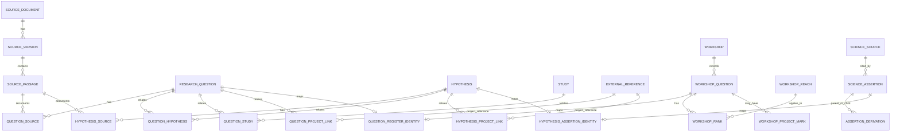

# Research questions, sources and program connections

Status: proposed logical model and local DuckDB implementation for design review, 2026-11-06. Questions and hypotheses may originate in workshops, science meetings, journal articles or other sources. A workshop is one context in which questions are recorded and ranked, not a required parent of a research question. The aim is to connect this research context to studies and program activities where a specific, attributed relationship is warranted. No model element automatically establishes that a program adopted a question or hypothesis.

## Relationships

Lines describe possible records, not obligations to find a source, rank, hypothesis, task or project for every question. The diagram simplifies workshop goal/objective grouping and evidence links; see [original vertical slice](relational-vertical-slice.md) and the two physical SQL files for the complete implemented columns.

## Dictionary and boundaries

| Object or relation | Purpose and constraints | Interpretation |
| --- | --- | --- |
| `research_question`, `hypothesis` | Source-independent domain objects with local integer keys, wording, origin and status. | A question asks something; a hypothesis proposes an answer. Neither requires a workshop. Existing optional single-passage columns remain for compatibility. |
| `question_source`, `hypothesis_source` | Many-to-many links to `source_passage`, keyed by object, passage and role, with attribution, status and scope. | Accommodates multiple cited passages and different source roles. A later mention is not automatically the origin or support. The migration populates the known workshop passages; it does not invent a source passage for the assistant-formulated SC-08. |
| `question_hypothesis`, `question_study`, `hypothesis_study` | Typed and attributed links with optional passage, status and scope. | A relevance proposal is not proof of original study purpose, adoption or causation. |
| `question_project_link`, `hypothesis_project_link` | Direct typed links to existing external project references, with optional passage and attribution, required status, and scope. | No actual project links are fabricated in this increment. Like other prototype links, the FK does not enforce that `external_reference.entity_kind` is `project`; importers must validate it and the enterprise design must strengthen this. |
| `research_register.workshop_*` | Source-specific workshop context, goal/objective grouping, question wording and cell, reach ranks and recorded project marks. | Rank is not evidence strength. Marks have unconfirmed semantics and are not project links. Local WQ identifiers are not enterprise IDs. |
| `research_register.science_source`, `science_assertion`, `assertion_derivation` | Source-specific extracted assertions, their source, locators, limits, statuses and proposal derivations. | A source assertion can be a finding, interpretation, hypothesis or other kind; do not convert all assertions to findings. Current extracted records remain staging records. |
| `question_register_identity`, `hypothesis_assertion_identity` | Explicit local mappings between the common model and reviewed worksheet representations. | These reconcile copies for the pilot; they are not generic entity resolution or approved enterprise mappings. Mapping endpoints in `main` have FKs. DuckDB cannot enforce cross-schema FKs to `research_register`, so the importer validates endpoints and wording and `research_alignment_issues` exposes drift. The multi-entry report stops if that view finds an issue. |

## Worked checks

- **Bertom:** existing question 1 is explicitly mapped to WQ-39 after exact wording reconciliation; its four workshop ranks remain separate from the later candidate connection to the historical survey and project 65. The report continues to show the candidate relation and imported feature context without inventing a monitoring task or survey exposure.
- **Steamboat:** hypothesis 1 maps to SC-08 as the same local assistant-proposed formulation, not an adopted hypothesis. The two worksheet derivation links remain separately inspectable; the existing planned objective/criterion association remains distinct from a measured result. Full Steamboat science and performance evidence is not yet migrated to the common model.
- **Additional source:** a synthetic journal-origin question and hypothesis, two source passages and a provisional project connection were exercised in a temporary test database. They require no workshop record or ranking and are not real program records.

## Implementation and unresolved work

[Research-register DDL](../schemas/duckdb-research-registers.sql) stores the imported source representations; [alignment DDL](../schemas/duckdb-research-alignment.sql) adds common-model relationships, views and mapping diagnostics. [Alignment migration](../scripts/duckdb-align-research-registers.R) uses exact wording checks before mapping WQ-39 and SC-08, adds the other 48 questions with workshop passage locators, and creates a new database. The local result is `dev/outputs/duckdb/restoration-research-aligned-v5.duckdb`. The migrated 49 questions and 196 ranks are accessible in `workshop_question_model` and `workshop_rank_model`.

The earlier `restoration-research-migration-v1.duckdb` and aligned v1–v3 copies omitted Restoration Features because a file copy missed uncheckpointed DuckDB WAL changes. Use migration v3 and aligned v5 for this increment. The corrected copy helper checkpoints the source, disconnects, verifies no WAL and checks file hashes during copying. All other connections must be closed to avoid concurrent writers. Incomplete destination files are not automatically removed. These ignored development databases are not backups.

Workshop staging still duplicates question text and requires explicit reconciliation; the identity view and diagnostic are a transition, not a fully normalized final design. The one-to-one worksheet mappings are bounded to this pilot and do not resolve multiple independent sources that express a similar question. Source-version identity for journal records, attribution, statement versioning, multi-passage evidence for relationships and project entity-kind enforcement require further design. The workbook checks, full study instance, remaining source catalog and Steamboat objectives/criteria are still to be migrated. Existing worksheet reports have not been rewritten and source JSON files are retained. Enterprise integration, data ownership and practitioner review remain open.
