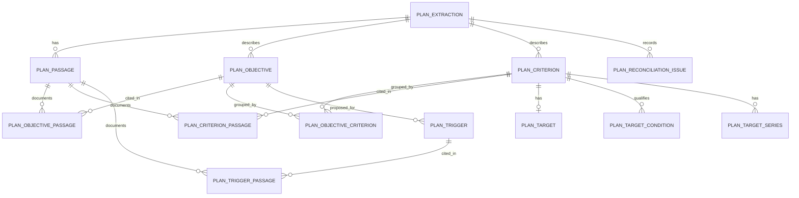

# Steamboat planning extraction in DuckDB

The local planning slice preserves the reviewed Steamboat Island feasibility extraction as source-specific relational data. It contains **four objectives, eleven planned criterion assertions and five proposed response-trigger groups**. These are not measurements, findings of attainment, completed actions or confirmed EMMA records. The source-based summaries and criterion-to-objective groupings are analyst work; their qualifiers and unresolved discrepancies remain explicit.



`plan_target` preserves single stated target fields and wording. `plan_target_series` stores one value per criterion, source label and year, with values **as reported** so thresholds, ranges and explanatory text are not silently converted to numeric observations. It retains the explicitly stated year-zero and later-year bases where supplied. `plan_target_condition` separates stated conditions from targets. Passage junctions retain PDF page, printed page and section. The benefit, criterion references, detailed objective pages and reconciliation issues have separate tables in the [physical DDL](../schemas/duckdb-plan-extraction.sql). Local SI identifiers are worksheet identifiers, not EMMA IDs.

The source-side records do not overwrite the earlier `main.project_objective` and `main.performance_criterion` pilot entries. A bounded reconciliation proposes that pilot objective 3 summarizes SI-O3 and pilot criterion 1 summarizes SI-C04. Both refer to the same feasibility version and cited pages; neither mapping establishes EMMA identity or attainment. The objective summary omits the 1950s baseline, project-area scope and acreage measure; the criterion worksheet adds the individual-location scope. [Reconciliation DDL](../schemas/duckdb-plan-reconciliation.sql) preserves both texts, basis, limitations and `analyst-proposed` status. DuckDB cannot enforce the cross-schema worksheet endpoints, so the migration checks endpoints and source version, and `plan_reconciliation_issues` detects missing or changed worksheet wording. The Steamboat report checks that diagnostic when available. Relationship status on `plan_objective_criterion` is also `analyst-proposed`, reflecting the worksheet's grouping by named measure. A criterion can exist without an implemented EMMA record or an assessment.

## Reproduce and inspect

With the dependencies and spatial extension configured as in the [Restoration Features guide](../features/restoration-features-duckdb.md), and all other database connections closed, create a **new** database from the aligned prototype:

```text
Rscript dev/scripts/duckdb-migrate-plan-extraction.R dev/outputs/duckdb/restoration-research-aligned-v5.duckdb dev/outputs/duckdb/restoration-steamboat-plan-new.duckdb "../UMRR/HREPs/Steamboat_Island/Steamboat Island HREP - Final Report w Appendices.pdf"
```

The third argument handles the locally relocated PDF. The worksheet retains its original recorded path; the script checks the PDF SHA-256 against the reviewed worksheet and stores the worksheet SHA-256. It checkpoints and copies the existing database before importing in a transaction, refuses to overwrite, and may leave an incomplete destination on failure. The prior database remains unchanged apart from checkpointing. The current local output is `dev/outputs/duckdb/restoration-steamboat-plan-v3.duckdb`; failed earlier v1/v2 outputs are incomplete. These ignored files are not backups.

The database has 56 year-by-year target values, ten target conditions and four open reconciliation issues, in addition to the objective, criterion and trigger records. Automated reconciliation compares all objective texts and source pages, criterion summaries and statuses, series years and values, trigger conditions and actions, and selected links and counts to the reviewed worksheet. It also verifies that the full 27-layer GIS import remains present. The [original worksheet](../goals/steamboat-island-objectives-criteria.json) and [source review](../goals/steamboat-island-objectives-criteria.md) remain available while migration and reporting are incomplete.

The subsequent [DuckDB-backed Steamboat report](../features/steamboat-duckdb-report.md) migrates and presents the separate Newton study-evidence chain alongside these plan records. The older exported report API and other worksheet reports have not yet been migrated. Neither increment completes the research inventory or establishes durable update/backup, enterprise table names, target evaluation, practitioner approval, or links to actual project features.

## Reproduce the reconciliation

With all other database connections closed, create a **new** copy of the combined planning and Newton evidence database:

```text
Rscript dev/scripts/duckdb-reconcile-steamboat.R dev/outputs/duckdb/restoration-steamboat-evidence-v1.duckdb dev/outputs/duckdb/restoration-steamboat-reconciled-new.duckdb
```

The script refuses to overwrite, checkpoints and verifies the source copy, verifies the known pilot and source wording, source fingerprint, target fields and page locators, then adds the two proposed mappings transactionally. A failed migration can leave an incomplete destination. The local result is `dev/outputs/duckdb/restoration-steamboat-reconciled-v1.duckdb`, which is ignored by Git and is not a backup. `plan_objective_comparison` and `plan_criterion_comparison` expose both wordings for review; older databases remain readable without this optional increment. Automated checks verify the mappings and fail reporting when mapped wording changes without reconciliation. These mappings are bounded to this worked example, not a general entity-resolution policy or approved enterprise schema.
