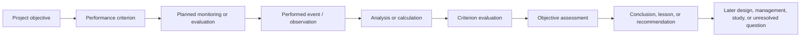

# HREP performance evaluation and workshop review

- Started: 2026-10-30
- Status: focused source review; requirements implications are assistant proposals unless explicitly identified as user direction or source statements
- Scope: added `UMRR/HREPs` and `UMRR/HREP_Workshops` holdings; this is not an exhaustive extraction of every project or workshop artifact
- Boundary: the review does not rate individual projects, validate every PER conclusion, assign a quality score to a report, or prescribe a replacement performance-evaluation workflow

## Inventory and source role

The HREP holdings include feasibility/design, plans/as-builts, operations and maintenance, inspection, monitoring, completion, and performance-evaluation artifacts for projects at different lifecycle stages. A filename-level inventory found 34 PER-like PDFs across the supplied older-project holdings, including files for Andalusia Refuge, Banner Marsh, Bay Island, Bertom and McCartney Lakes, Chautauqua Refuge, and Cottonwood Island. Some filenames are duplicate copies or editions; that count is an inventory lead, not a count of distinct completed assessments.

The workshop holding includes 67 PDFs spanning the 1996, 1999, 2002, 2005 and 2016 events. It records a continuing partnership practice of sharing project experience, science, engineering, monitoring and planning questions. Workshop materials are evidence of discussion and proposed priorities; they do not by themselves establish a project fact, an adopted decision or a scientific conclusion.

## Reviewed examples

| Artifact | What the artifact documents | Conceptual-model value | Limit that remains visible |
| --- | --- | --- | --- |
| [Andalusia Refuge 2015 PER](../../../UMRR/HREPs/Andalusia_Refuge/2015_PER_Andalusia_Refuge_HREP_Small_Optimized.pdf) | A post-construction assessment organized around DPR goals/objectives, evaluation criteria, observations, results, success statements, conclusions, and lessons/recommendations; it reports both monitored values and an instance where no vegetation surveys were conducted | Demonstrates a concrete project-performance path: objective → criterion → monitoring/observation → result → evaluation → conclusion/recommendation. It also shows why the evidence, method, period, feature/condition and uncertainty must remain traceable at each assessment | The report is one project-specific synthesis; its structure does not prove that all source data, assumptions, feature conditions or lessons are comparable across projects |
| [Bertom and McCartney 2014 mussel monitoring report](../../../UMRR/HREPs/Bertrom_McCartney_Lakes/2014_BertomMcCartney_PER_Mussels.pdf) | A focused monitoring study of a fish-and-mussel enhancement area, including habitat and control-channel comparison context; it says five-year surveys had been planned but the documented survey was not conducted until 2014 | Tests the separation of planned collection, actual survey, feature/condition, sampling design, observation, analysis and learning. It is a promising future cross-system test because the report names an implementation, comparisons and temporal gap | This review has not matched its locations, samples or findings to EMMA, Restoration Features or a source dataset; it cannot yet support a production identity rule or a project-success claim |
| [2016 monitoring breakout instructions](../../../UMRR/HREP_Workshops/2016_UMRR_HREP_Team_Meeting/D3_06_Monitoring_Break_Out_Session_Instructions.pdf) | The workshop states that 55 HREPs had been completed, describes monitoring and assessment practice, and asks participants to identify monitoring that supports project-success determination and future-project learning. It notes that early methods may no longer answer current questions | Direct evidence that monitoring must support both project assessment and transferable learning, with method fitness, lifecycle stage and unanswered questions visible | Instructions record the workshop task, not its final recommendations or their adoption |
| [MVR performance-monitoring update](../../../UMRR/HREP_Workshops/2016_UMRR_HREP_Team_Meeting/D3_04_Mitvalsky_MVR_PER_Update.pdf) | The presentation characterizes traditional reports as slow, constrained by limited data, project-by-project, and insufficiently connected to surrounding systems or management alternatives; it identifies possible approaches including site inspections, feature-type monitoring, targeted project assessment and ongoing data collection | Source-backed expression of the problem this component addresses: retain enough lineage to review assessments, compare learning across projects without erasing context, and connect findings to later management/design questions | This is an MVR presentation and a historical proposal/discussion artifact, not an adopted program-wide standard or a finding that every PER is deficient in the same way |
| [2016 HREP team meeting summary](<../../../UMRR/HREP_Workshops/2016_UMRR_HREP_Team_Meeting/2016 UMRR HREP Team Meeting Summary.pdf>) | Partner statements, project updates, science/restoration discussion and monitoring themes across USACE, USGS, states, USFWS and NGOs | Confirms that the integration problem is collaboration across disciplines, organizations and project stages, rather than merely compiling reports | A meeting summary cannot establish the validity of any individual ecological claim reported in a presentation |
| [2005 Design, Construction, and Monitoring workshop agenda](../../../UMRR/HREP_Workshops/2005_EMP_Design_Handbook_Workshop/00_2005_UMR_EMP_Design_Construction_Monitoring_Workshop_Final_Agenda.pdf) | A program workshop agenda spanning HREP database, monitoring, construction and several restoration practice types | Shows that cross-disciplinary knowledge exchange and database/monitoring coordination are long-running program activities, not a new workflow imposed by this project | An agenda establishes planned discussion topics only |

## Requirements implications

The reviewed material strengthens the existing proposed requirements; it does not require a separate PER governance framework.

| Requirement | Refined implication from the review |
| --- | --- |
| R-01, R-07, R-13, R-19 | Preserve source/version/locator, observations or datasets where available, analysis lineage, assessment history and access gaps so a future reviewer can inspect an assessment rather than inherit only its conclusion |
| R-04, R-05, R-14 | Keep objective, criterion, evaluation method, reporting interval, result, uncertainty, conclusion and objective-level assessment distinct. A missing survey, unavailable data or unsuitable method is evidence of a gap, not an automatic failure or success outcome |
| R-06, R-15, R-16 | Link findings and lessons to a later decision, design change, monitoring change, follow-up question or explicit unresolved status. A recommendation is not evidence that an action was adopted or completed |
| R-08, R-10, R-11, R-20 | Support comparison across projects and feature types only with stated implementation/condition, spatial/temporal context, study design and inference limits. A shared feature label, project type or spatial overlap is insufficient to establish comparable outcome or causal effect |
| R-17, R-18 | Retain workshop discussion, contributor role, source basis and review/adoption state as collaboration artifacts. They can identify questions, hypotheses, candidate practices and learning needs without being silently promoted to project facts or decisions |

## Proposed assessment lineage

The Andalusia PER supplies a useful review pattern, without prescribing its report format:

Each arrow is an attributed linkage: it needs source evidence, scope, lifecycle/review state and a responsible contributor or system where known. The chain permits a gap at any point. For example, an intended survey may not occur; a result may be available without a formal criterion; or a lesson may be documented without evidence that a later project adopted it.

## Next evidence package

The most useful next case is a bounded cross-system review of an older HREP with a PER and a documented implementation. Bertom and McCartney is a candidate because the supplied report identifies an intervention, comparison context and monitoring history. Before choosing it, verify that EMMA and Restoration Features records can be accessed for the same project.

For one selected objective or question, inspect only:

1. the EMMA project, objective, criterion, monitoring task and task-event references available;
2. the Restoration Features implementation and authoritative spatial reference, including status/condition where present;
3. the report's source-located method, observation/data reference, analysis, evaluation and conclusion; and
4. any workshop-originated question, recommendation or later decision, marked as discussed, proposed, adopted, performed or unknown.

Where spatial relationships are material, retain the input representations, operation, parameters/tolerance, temporal alignment and output version. Do not create production links, infer missing identifiers or treat the review as a judgment that the project succeeded.
