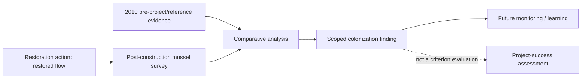

# Marsh Lake: Pomme de Terre mussel monitoring linkage record

- Started: 2026-10-29
- Status: source-based cross-case validation of the user-accepted attributed-linkage pattern; not SME-reviewed, not a production EMMA/Restoration Features record, and not a determination of Marsh Lake project success
- Context: the user identifies Marsh Lake as a State of Minnesota ecosystem-restoration project relevant to this design test but outside UMRR. The supplied package now includes the full 2011 final feasibility report/environmental assessment, its Monitoring and Adaptive Management appendix, and later monitoring/reporting artifacts. This expands the planning evidence while preserving unresolved production-system and as-built links.
- Primary sources: `UMRR/MN/Marsh_Lake/11Nov18 Marsh Lake FINAL FR&EA.pdf`, *Marsh Lake Ecosystem Restoration Project Final Report* (2011 report with errata), SHA-256 `607641cf04e1180455e17075f84d79bcdd3070094901b70e0ff0b2cf69170eda`; `UMRR/MN/Marsh_Lake/FEASIBILITY_REPORT_MONITORING_PLAN_MODA.pdf`, Appendix R, *Monitoring and Adaptive Management*, April 2011, SHA-256 `026822a4a57a15b37d6f73b44e5a6365983d82c7c892aabc47c866b3e94a2977`; and `UMRR/MN/Marsh_Lake/PommeDeTerre_Colonization_21Nov2023.pdf`, Sietman et al., *Survey of Freshwater Mussels in a Restored Reach of the Lower Pomme de Terre River, Minnesota*, revised November 2023, SHA-256 `9ac74938176f723f55faa3c6f6e659da76d07fb9bb13bd1ccfdddef551328cb1`
- Design basis: [minimum-record pattern](../architecture/prospective-study-linkage-minimum-record.md), [science-restoration relationship analysis](../architecture/science-restoration-relationships.md), and [Steamboat mussel record](steamboat-prospective-study-linkage.md)

## Candidate linkage record

| Component | Recordable connection | Source/status | Limit retained |
| --- | --- | --- | --- |
| **Project objective and restoration context** | The final report identifies restoring geomorphic and floodplain processes to the Pomme de Terre River as one of nine planning objectives. The recommended plan includes restoring the river to its historic channel; the later report says mainstem flow was reconnected to that channel in October 2018 | Final Report PDF p. 9 / printed p. 3; pp. 125–128 / printed pp. 119–122; Appendix R PDF pp. 2–5; 2023 mussel report PDF pp. 2–3 | The planning record does not supply an EMMA identifier, Restoration Features identity, as-built geometry or complete operating history. The later report supports flow reconnection, not those missing production references |
| **Expected benefit and scientific uncertainty** | Appendix R states that mussels were expected to recolonize the restored historic channel after fine sediment washed out, while explicitly noting uncertainty about recolonization | Appendix R PDF p. 2 | This is an anticipated ecological response, not a project performance criterion or a demonstrated result at the time of planning |
| **Pre-project study/design → evidence collection** | The final report and appendix describe 2010 reference-reach and impact-area surveys, including random 0.25-m² quadrats, qualitative timed searches, population/demographic/community descriptors, and site maps. They plan post-construction qualitative and quantitative surveys after three years of restored flow, with scheduled monitoring at Years 3, 6 and 10 | Final Report PDF pp. 126–128 / printed pp. 120–122; Appendix R PDF pp. 3–4 | The final report says a more complete experimental design would be developed during detailed design. The review has not recovered that design, underlying 2010 data, a complete monitoring-task register or an EMMA-equivalent record |
| **Implementation → post-construction monitoring** | The later report records flow reconnection in October 2018 and a restored-channel mussel survey on 2022-08-09, nearly four years later | 2023 mussel report PDF pp. 2–3 | The source does not provide a linked construction feature ID, as-built geometry, operating history or a complete list of intervening monitoring events |
| **Observation/data → analysis** | The 2022 survey used timed search across accessible habitat, wading/snorkeling/scuba as conditions allowed, identification, length measurement, external-annuli age estimates and catch per unit effort. It compared the restored reach with 2007/2010 upstream-reference data | 2023 mussel report PDF pp. 3–5 | The lower third of the reach was largely not searched because depth/current limited sampling. The review does not reproduce calculations from raw files or treat observed age as exact colonization time |
| **Analysis → scoped finding** | Authors report 163 mussels of 9 species in the restored reach during 19 hours of 2022 sampling, with a total CPUE of 8.6 mussels/hour. They report multiple species colonized within four years, while abundance/richness remained lower than the upstream reference reach | 2023 mussel report PDF pp. 2, 5 and Tables 1–2 | This is a source-scoped study finding, not proof that all restoration objectives were met or that the restoration action alone caused every observed difference |
| **Scientific evaluation → formal performance assessment** | Appendix R explicitly says mussel recolonization was not a project objective and had no performance criteria indicating a need to modify the project. It identifies the work as adaptive-management learning about ecological effects | Appendix R PDF pp. 2 and 4 | A mussel finding cannot be substituted for a criterion evaluation, objective assessment, project-success result or adaptive-management decision |
| **Future learning/decision link** | The 2023 report recommends future monitoring of the restored channel and reference reach to assess change in assemblage composition and age structure over time | 2023 mussel report PDF p. 6–7 | No subsequent monitoring record, decision, modification or assessment is asserted in this review |

## What the full feasibility report resolves and what remains open

The final report resolves the earlier gap in project rationale, planning objectives, alternative selection, recommended actions, anticipated mussel effects and intended monitoring. It confirms that the mussel work belongs to the restoration-action and adaptive-management learning path, rather than a formal mussel performance criterion. It also documents that detailed design was expected to complete the experimental design.

The record remains partial for production integration: no EMMA identifier, Restoration Features feature record, as-built geometry, detailed-design study document, monitoring-task/event register, raw data reference, later decision, or objective-level assessment has been recovered. The model must preserve those explicit gaps without treating the available planning and monitoring evidence as incomplete or invalid.

## Relationship path tested

This path provides a source-backed example of L-03 through L-05 and L-08's learning purpose. It demonstrates why L-06/L-07 must remain distinct: the available mussel evaluation is scientifically useful even though it cannot assess a formal project criterion or objective.

## Relationship refinements supported by this test

1. **Expected benefit is not necessarily a project objective or performance criterion.** It can still justify monitoring and generate useful scientific evidence.
2. **A restoration implementation may be documented at project-action level before its feature-level identity is recovered.** Preserve the action and source without inventing a GIS/asset record.
3. **A study comparison needs its own design and coverage limits.** Reference data, inaccessible areas and method constraints belong with the analysis/finding path.
4. **Scientific learning and project-success assessment are independently valuable paths.** A source can support the former while leaving the latter unassessed.
5. **Planning and detailed design can refine one another.** Retain the feasibility-level study design and its stated later-design dependency rather than representing either as the final method without evidence.

No conclusion here creates an EMMA record, applies UMRR performance standards to Marsh Lake, or represents a cross-program outcome comparison.
