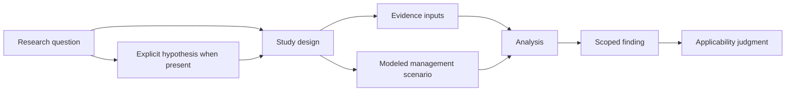

# Reno Bottoms: study-design linkage record

- Started: 2026-10-29
- Status: third test of the user-accepted attributed-linkage pattern; source-based extraction from one publication, not SME-reviewed, not a project record, and not a production EMMA or Restoration Features record
- Purpose: validate the pattern against a contrasting scientific starting point: a completed modeling study associated with a restoration project in planning, with explicit research questions and scenario design but no extracted formal hypothesis, project-system identifier, installed feature record, or post-construction evaluation
- Source: `UMRR/UMESC/s10980-025-02144-7.pdf`, Trumper et al. (2025), *Future forest conditions under alternative management and hydrological scenarios in the Upper Mississippi River floodplain*, 21 PDF pages, DOI `10.1007/s10980-025-02144-7`, SHA-256 `076fc5dbfd5fc7d15789ec2da6cd949244c24af6cbb2a568b615bb508f08d810`
- Design basis: [minimum-record pattern](../architecture/prospective-study-linkage-minimum-record.md), [prospective linkage review](../architecture/prospective-study-linkage-review.md), and [relationship analysis](../architecture/science-restoration-relationships.md)

## Candidate linkage record

| Component | Recordable connection | Source/status | Limit retained |
| --- | --- | --- |
| **Research context and questions** | The authors evaluated combined forest management, local hydrogeomorphic modification and regional hydrologic change at Reno Bottoms, where they describe a forest restoration project as planned. They ask how inundation varies among scenarios, how management changes biomass/composition across scales, and the relative influence of management and hydrology | PDF p. 3–4; author-stated study purpose and three questions | The paper does not label these questions as a formal hypothesis. No workshop priority link, program project identifier, or designer adoption is inferred |
| **Research question → study design** | The study uses the LANDIS-II model to simulate 100 years of forest succession under combinations of hydrogeomorphic management, forest management and future hydrology | PDF p. 1, p. 3–4 and p. 6–8; author-stated methods | This is a source-backed study design, but its publication DOI, model code, data release and planned restoration project are different records. The record does not treat them as one identity |
| **Design → management scenarios** | Hydrogeomorphic scenarios: baseline, channel closures, elevation enhancement, and elevation enhancement plus closures. Forest scenarios: no forest management; planting with reed-canarygrass suppression and forest expansion; planting/thinning with suppression/expansion. Hydrology scenarios: random and trending | PDF p. 6–7; scenario names/definitions supplied by authors | These are modeled alternatives. They are not evidence of constructed closures, elevation enhancement, planting, thinning or vegetation control at Reno Bottoms |
| **Design → evidence inputs** | The study used forest-inventory data, inundation-duration mapping derived from terrain and Adaptive Hydraulics model output, and scenario inputs; it ran 24 factorial scenario combinations with three replicates each | PDF p. 4–8 | The review does not establish data custody, complete input versions, model code availability, or an EMMA monitoring-task relationship |
| **Design → analysis and findings** | Authors analyzed inundation duration, total/species biomass, composition and relative importance of agents of change. They report that intensified management reduced the magnitude/extent of projected biomass declines but did not prevent overall declines under modeled conditions | PDF p. 7–11 and abstract; author-reported modeling result | Projected scenario results are not post-construction observations or proof that a particular restoration implementation will produce the result |
| **Study → planned restoration context** | Potential hydrogeomorphic treatments were designed by a multi-agency, multidisciplinary team for forest habitat; the paper says USACE supported a habitat restoration project at Reno Bottoms and cites a 2023 feasibility report | PDF p. 4 and p. 6; author-reported planning context and cited source | The feasibility report itself, EMMA record, Restoration Features records, actual implementation status, and condition history were not supplied or reviewed. Do not call the planned project an installed treatment |
| **Finding → management applicability** | The authors state that spatially explicit modeling can help managers prioritize where management may be consequential, while noting limits under wetter conditions | PDF p. 16–18 and abstract; author interpretation | A local applicability assessment, management decision and subsequent monitoring plan have not been extracted. Model findings remain scoped to the described scenarios and inputs |

## What this validates

The record demonstrates that a study can begin with author-stated research questions and a rigorous design without an explicitly named hypothesis in the source. The conceptual model must therefore allow both paths:

An omitted formal-hypothesis link is not a defect in the study. The attributed linkage record must preserve whether the source states a hypothesis, uses questions directly, or has only a later analyst formulation. This prevents the system from rewriting source science into a required template.

## Comparison with the prior tests

| Test | Starting evidence | What it establishes | What remains outside reviewed evidence |
| --- | --- | --- | --- |
| [Steamboat mussel prospective record](steamboat-prospective-study-linkage.md) | Question context, proposed hypothesis, external study and ancillary local benefit | A science-informed opportunity can be preserved without claiming a local study or effect | Local design, implementation, monitoring and evaluation |
| [Steamboat performance-evaluation record](steamboat-performance-evaluation-linkage.md) | Formal objective, planned criterion and planned schedule | A formal project-performance path can be preserved without fabricating a hypothesis or result | Implementation identity, task/event, observations, assessment and decision |
| This Reno Bottoms record | Author-stated questions, scenario design, inputs, analysis and modeled findings | A scientific study path can be represented directly from questions through design and scoped findings | Formal hypothesis, program project identity, feature records, installation, monitoring and local decision |

## Refinement result

The three tests retain the common attributed-linkage envelope: precise relationship, attribution/evidence, scope, lifecycle/review state, and responsible contributor or system where known. Reno Bottoms adds one candidate relationship rule for review:

> A study may address a research question directly when a formal hypothesis is absent or not extracted; a hypothesis is a distinct, optional attributed proposition rather than a mandatory intermediary.

This rule is a proposed refinement of relationship meaning. It does not weaken the need to represent explicit hypotheses where they exist, create a new requirement ID, or authorize a database, ontology, project-system or monitoring change.
