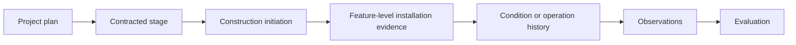

# Steamboat Island: construction-initiation linkage record

- Started: 2026-10-29
- Status: fourth test of the user-accepted attributed-linkage pattern; source-based extraction from a public USACE release, not SME-reviewed, not a construction-status system of record, and not a production EMMA or Restoration Features record
- Purpose: test the operational transition from a planned project to a documented construction-initiation event while preserving the difference between contract/construction evidence, a specific installed restoration feature, its condition, and a performance outcome
- Primary source: [USACE Rock Island District Release 23-039, “Groundbreaking to mark start of local habitat restoration project”](https://www.mvr.usace.army.mil/Media/News-Releases/Article/3545427/groundbreaking-to-mark-start-of-local-habitat-restoration-project/), published 2023-10-02; accessed for this review 2026-10-29
- Design basis: [minimum-record pattern](../architecture/prospective-study-linkage-minimum-record.md), [Steamboat performance-evaluation record](steamboat-performance-evaluation-linkage.md), [Steamboat prospective record](steamboat-prospective-study-linkage.md), and [Restoration Features review](../architecture/restoration-features-documentation-review.md)

## Candidate linkage record

| Component | Recordable connection | Source/status | Limit retained |
| --- | --- | --- | --- |
| **Project → construction-initiation event** | USACE and USFWS announced a public groundbreaking ceremony on 2023-10-04 to mark the start of construction for the Steamboat Island HREP | Release 23-039, published 2023-10-02; public communication about a scheduled event | The release supports a construction-start milestone. It does not document completed construction work, feature-level installation, coordinates, quantities, as-built condition or acceptance |
| **Project → contracted stage** | The release states that a Stage I contract had been awarded earlier in 2023, for $8.8 million | Release 23-039 | Contract award is not evidence that every planned feature was built, completed, accepted or functioning. Contractor and amount are not treated as feature identity |
| **Construction stage → planned project purposes** | The release says rehabilitation/enhancement efforts over subsequent years would increase aquatic habitat diversity, diversify floodplain forest habitat, restore island acreage, and protect/enhance backwater habitat | Release 23-039 | These are project-level intended purposes. They do not identify the specific practice/feature, condition, ecological response, monitoring task or criterion result addressed by construction work |
| **Construction activity → Restoration Features implementation** | No linked Restoration Features identifier, feature class, geometry, planned/actual status record, installation date, as-built reference or condition history is present in the release | Explicitly absent from reviewed release and local pilot artifacts | The model must retain this as a missing cross-system link, rather than treating the construction announcement as a feature record |
| **Construction activity → monitoring/evaluation** | No monitoring event, observation, dataset, criterion evaluation, objective assessment or adaptive-management decision is reported in the release | Explicitly absent from reviewed release | A construction-start milestone is neither a completed monitoring task nor evidence of project performance |

## What this validates

The source adds a distinct implementation-lifecycle path:

Only the contracted-stage and construction-initiation links are source-supported in this test. The remaining nodes show the additional evidence necessary to answer feature- and outcome-level questions. A project milestone must not be substituted for a restoration-feature implementation, observation, evaluation or project-success assessment.

## Refinement result

This record supports a proposed lifecycle distinction:

> A project may have planning, contract, construction-initiation, feature-installation, condition/operation, monitoring, evaluation and assessment evidence at different times and granularities. Each connection must retain its own source, scope and lifecycle state.

This is a conceptual refinement of L-03/L-04/L-06/L-07. It does not establish the current physical condition of Steamboat, create a construction or feature-status vocabulary, assign a cross-system join, or alter production records.

## Smallest remaining operational source package

To validate feature-to-observation and evaluation links, the next source package should contain one or more of: an as-built or construction completion record; an exported Restoration Features record with stable identifier, planned/actual state and geometry; an EMMA monitoring task/event reference; a monitoring report or dataset with method/time/place; and a criterion-evaluation or objective-assessment record. Any one artifact can be useful if its source limits are retained.
