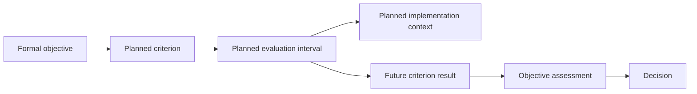

# Steamboat Island: performance-evaluation linkage record

- Started: 2026-10-28
- Status: second test of the user-accepted attributed-linkage pattern; source-based extraction and assistant linkage, not SME-reviewed, not a production EMMA record, and not a performed performance evaluation
- Purpose: test the restoration/performance path where formal project objectives and planned criteria exist but an explicit scientific hypothesis, identified EMMA task/event, installed feature record and observed criterion result are not available in the reviewed pilot material
- Design basis: [minimum-record pattern](../architecture/prospective-study-linkage-minimum-record.md), [prospective linkage review](../architecture/prospective-study-linkage-review.md), [Steamboat restoration worksheet](steamboat-island-objectives-criteria.json), and [Steamboat conceptual-model review](../architecture/steamboat-conceptual-model.md)

## Candidate linkage record

| Component | Recordable connection | Source/status | Limit retained |
| --- | --- | --- | --- |
| **Formal project objective** | SI-O3, *Island restoration and protection*: restore 50% of lost island acreage/topography and protect it from erosion, measured by acres | `steamboat-island-objectives-criteria.json:objectives[SI-O3]`; feasibility report PDF p. 81 / printed III-15 and PDF p. 698 / printed K-5 | SI-O3 is a local worksheet reference, not an EMMA key. The extracted objective does not state an explicit scientific hypothesis |
| **Objective → performance criterion** | SI-C04: at 10 years, affected island acreage is not less than as-built acreage | `steamboat-island-objectives-criteria.json:criteria[SI-C04]`; feasibility report PDF p. 703 / printed K-10 | This planned criterion is distinct from a recorded result. It uses a future comparison to as-built acreage; the relevant as-built record is not linked in this pilot |
| **Related planned criterion schedule** | SI-C11 records Table X-4 planned constructed-island acreage targets for USI Head, NE Bank and West SE Island at Years 0, 1, 10, 25 and 50 | `steamboat-island-objectives-criteria.json:criteria[SI-C11]`; feasibility report PDF p. 170 / printed X-5 | The Appendix K and table scopes differ. The extraction retains both rather than silently merging them; neither establishes an actual installed feature or monitoring result |
| **Criterion → planned evaluation** | The report supplies future comparison years and an as-built-acreage reference for evaluation | Same source passages; source-based plan extraction | Specific EMMA monitoring-task and task-event identifiers, collection method, data location and responsible contributor are not in the reviewed pilot materials |
| **Planned evaluation → restoration implementation context** | The planned acreage schedule names constructed-island locations and provides target acreages | SI-C11 source above | A named location in a feasibility plan is not a Restoration Features identity or evidence that a feature was built. Planned implementation, actual installation and later condition remain different linkages |
| **Performance evaluation → objective assessment** | A future criterion evaluation could inform an SI-O3 objective assessment at the applicable interval | Proposed reasoning based on the EMMA conceptual chain and L-06/L-07 | No evaluation result, aggregation rationale, objective-assessment record or project-success judgment is available. No assessment is inferred from construction stage or scheduled monitoring |
| **Assessment → decision** | No island-objective decision or trigger is linked in this record | No located source in the reviewed scope | Absence in the pilot is an evidence gap, not evidence that no decision was made |

## What this tests

This record starts at an explicit restoration objective rather than a priority question or hypothesis. It confirms that the attributed-linkage pattern can preserve a formal evaluation path without forcing a scientific proposition into it:

The only source-supported links currently reach the planned criterion, planned schedule and planned implementation context. The future result, assessment and decision nodes are included to show what a completed lifecycle path would require; they are not current project facts.

## Comparison with the mussel study-linkage test

| Test | Strongest available starting evidence | Main unresolved links | Pattern behavior demonstrated |
| --- | --- | --- | --- |
| [Mussel prospective record](steamboat-prospective-study-linkage.md) | Workshop question, assistant-formulated hypothesis, external observational study and ancillary local benefit | Local adoption/design, planned collection, feature identity, local evaluation | Retains an externally informed scientific opportunity without claiming a formal project study or effect |
| This performance-evaluation record | Formal objective, planned criterion and evaluation schedule | EMMA task/event, implementation identity, observations, criterion result, assessment and decision | Retains a formal restoration-evaluation pathway without fabricating a hypothesis, scientific study or completed assessment |

Together, the records show why scientific hypothesis evaluation and project performance assessment need distinct but linkable paths. Both require provenance, scope, lifecycle/review state and references to existing systems; neither can turn an incomplete plan into an outcome.

## Refinement result

The second test supports retaining the attributed-linkage pattern as the common envelope. It adds one proposed requirement for later relationship review: an evaluation linkage needs an explicit **evaluation state** separate from the status of its criterion, monitoring task, implementation or objective. In this case, the evaluation is planned; the criterion is defined; the implementation and observations are unresolved; and no assessment is available.

This is a conceptual distinction for review, not a new EMMA field, status vocabulary, requirement ID or production change.
