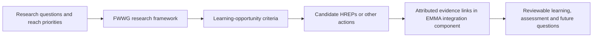

# 2025–2035 strategic plan and FWWG framework review

- Reviewed: 2026-11-02
- Status: focused source review. The strategic plan is marked **DRAFT**; the FWWG deck documents an active initiative, not an approved data model or implementation commitment.
- Scope: the latest supplied strategic-plan draft and October 2026 Fish and Wildlife Working Group presentation. This review connects them to existing project direction and does not replace the broader program-foundation review.

## Source status

| Source | Role and status | Review boundary |
| --- | --- | --- |
| [Draft 2025–2035 UMRR Strategic Plan](<../../../UMRR/KeyDocuments/Draft 2025-2035 UMRR Strategic Plan.pdf>) | Latest supplied strategic direction. It is explicitly labeled draft and describes a 2025–2035 program plan, goals, strategies and actions | Treat as current planning evidence, not final controlled policy or proof that an action has been funded, assigned or completed |
| [FWWG Restoration Science Research Framework presentation](../../../UMRR/FWWG/FWWG_Bouska_10_29_26.pptx) | October 2026 presentation by Kristen Bouska to the Fish and Wildlife Working Group. It describes a developing research-framework effort | Treat as initiative and presentation evidence. It does not establish approval, steward assignment, a system of record, or the result of planned next steps |

## Strategic alignment

The draft expressly frames UMRR as a continuous relationship among science, implementation and learning. It calls for accessible knowledge, science-based restoration, a project performance-evaluation framework, stronger HREP–LTRM exchange, a restoration science research framework, standardized HREP monitoring data, and a unified database with harmonized fields and metadata.

| Draft-plan action or direction | Implication for the science and restoration integration component of EMMA |
| --- | --- |
| Goal 1, Objectives 1.1–1.2: monitoring/research and accessible knowledge | Preserve source, study, dataset, analysis, finding and scope so a result can be recovered and communicated without losing its evidence limits |
| Goal 2, Objective 2.2, Strategy 2.2.2: performance-evaluation framework, success criteria, regular PERs and more rigorous assessment of novel techniques | Retain objective, criterion, planned and performed monitoring, method, result, evaluation, assessment, lesson and later action as distinguishable records and linkages |
| Goal 3, Objective 3.1: HREP–LTRM exchange and staff working at the interface | Make partner responsibility, source system, review state and unresolved handoff visible while respecting existing workflows |
| Goal 3, Objective 3.2: restoration science research framework and learning-opportunity criteria | Connect priority questions, hypotheses or direct study designs, project practices, existing evidence and gaps so partners can identify defensible learning opportunities |
| Goal 3, Objective 3.3: standardized monitoring, data sharing, unified database and metadata | Support references among EMMA, Restoration Features, LTRM/research holdings and source artifacts. The draft does not settle the physical integration architecture or ownership boundaries |
| Goal 4, Objective 4.2: knowledge transfer, accessible historical/current documents and partner coordination | Preserve attribution, version/locator, review history and explicit unknowns across staff and organizational transitions |

This confirms the user’s direction that the component should support the program’s science-and-restoration integration goals. It does not change the project boundary: physical database implementation, production changes, ontology publication and new monitoring obligations remain deferred.

## FWWG initiative and EMMA relationship

The FWWG presentation describes a restoration-science research framework that organizes and prioritizes uncertainty about ecological response to restoration, identifies restoration projects that offer learning opportunities, and uses restoration goals, objectives and research questions with reach-based prioritization. Its stated next steps include finalizing the weighting/priority views, identifying learning-opportunity criteria, developing ways to operationalize the framework, and publishing it.

The presentation and the project’s existing workshop-priority register describe complementary layers:

The framework provides the programmatic process for selecting and coordinating learning opportunities. The EMMA component is a proposed information-infrastructure contribution: it can preserve the evidence, scope, spatial context, review state and system references behind a candidate opportunity and later learning. It does not replace FWWG deliberation, reach prioritization, scientific study design or partner decisions.

## Requirements implications

The new sources strengthen the existing proposed backlog without adding a requirement ID.

| Requirements | Refined review implication |
| --- | --- |
| R-02, R-09, R-10, R-16 | Retain priority question, hypothesis when present, study/design, applicability, evidence gap and learning-opportunity rationale as different records or attributed linkages |
| R-03, R-07, R-11, R-20 | Carry study design, data/analysis lineage, spatial/temporal scope and inference limits into any cross-project learning claim |
| R-04–R-06, R-14, R-15 | Trace performance evaluation from objective/criterion through planned and performed evidence, assessment, lesson, decision or an explicit unresolved state |
| R-01, R-13, R-17–R-19 | Preserve source status, responsible partners/systems, review state, historical artifacts and access gaps so the framework can survive distributed stewardship and staff changes |

## Next review boundary

Use the FWWG framework as the program context for choosing a learning-opportunity case, but do not ingest or model every priority question before testing a case. The next bounded case should connect one FWWG/workshop priority or uncertainty to one project’s EMMA, Restoration Features, monitoring/observation and spatial references, with each claimed connection attributed and reviewable.
